# PiNI 实验详细报告

主要图表与简要结论见 [EXPERIMENT_RESULT.md](EXPERIMENT_RESULT.md)。以下保留全部已完成配置及机制检查；待完成项不是成绩。

# PiNI 复现与空间加噪 CBM 实验结果

本报告由已完成的实验输出生成；正在训练或评估的配置不填写成绩。研究 goal 保持 active，直到官方复现、训练方式对照与背景干预完成。

## 主要结果

目的：在真实概念监督、相同初始化和固定训练/验证/测试协议下，检验 RGB 噪声能否提高概念识别与稀疏分类。分类头仅读取 18 个概念概率，无图像特征旁路。NEC 是每类别非零概念连接数，不是模型参数数目。

| 方法 | 测试分类准确率 | NEC | 原生概念 mAP | 宏精确率 @0.5 | 宏召回率 @0.5 |
|---|---:|---:|---:|---:|---:|
| clean matched head | 99.02% | 4.50 | 91.19% | 87.50% | 89.59% |
| mean_independent | 98.15% | 4.80 | 91.00% | 88.41% | 85.55% |
| noise_independent | 97.24% | 5.20 | 90.58% | 88.36% | 82.61% |
| mask_sequential | 98.79% | 4.40 | 91.21% | 87.04% | 89.76% |
| mean_sequential | 98.69% | 4.40 | 91.22% | 86.99% | 90.29% |
| noise_sequential | 99.30% | 4.20 | 91.07% | 86.85% | 90.76% |
| noise_joint | 99.00% | 4.20 | 91.16% | 87.07% | 89.33% |
| mean_separate_heads | 98.96% | 4.40 | 91.32% | 86.97% | 90.16% |
| noise_separate_heads | 99.05% | 4.30 | 91.14% | 86.86% | 90.74% |
| local_mean | 99.13% | 4.50 | 90.81% | 87.26% | 88.56% |
| local_noise | 98.52% | 4.40 | 90.30% | 87.34% | 86.74% |
| full_joint_mean | 99.24% | 4.10 | 90.72% | 86.64% | 89.59% |
| full_joint_noise | 98.90% | 3.90 | 90.40% | 86.35% | 88.60% |
| region_mean | 99.05% | 4.40 | 89.68% | 86.09% | 89.37% |
| region_noise | 98.62% | 4.50 | 89.29% | 85.58% | 89.64% |
| fixed_mean | 99.15% | 4.40 | 89.72% | 85.97% | 89.60% |
| fixed_noise | 98.71% | 4.30 | 89.40% | 85.68% | 89.34% |
| local clean matched head | 99.45% | 4.30 | 90.65% | 86.87% | 89.71% |
| region clean matched head | 99.32% | 4.30 | 89.64% | 85.85% | 90.29% |

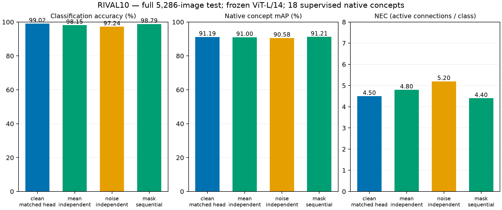

干净模型全 18,987 个训练样本拟合分类头：准确率 98.94%，NEC 4.50；表中使用与加噪实验相同的 6,003 个分类头训练样本。主体定位测试 IoU 73.16%，正概念区域 IoU 35.07%。

可解释性检查：将预测概率二值化后，分类准确率 96.71%，NEC 5.10；原生真值二元概念分类头为 92.45%。预测概念中的概率或系统性误差能携带额外类别信息，因此高分类成绩不能代替原生概念精度。

## 真实 Figure 4 风格可视化

目的：检查主体均值增强与背景随机扰动是否实际发生。六个样本按固定类别/概念选择验证集中首个文件，不按改善幅度挑选。μ 使用 RGB RMS，σ² 使用实际 RGB²；列内共用色标，采样不放大。

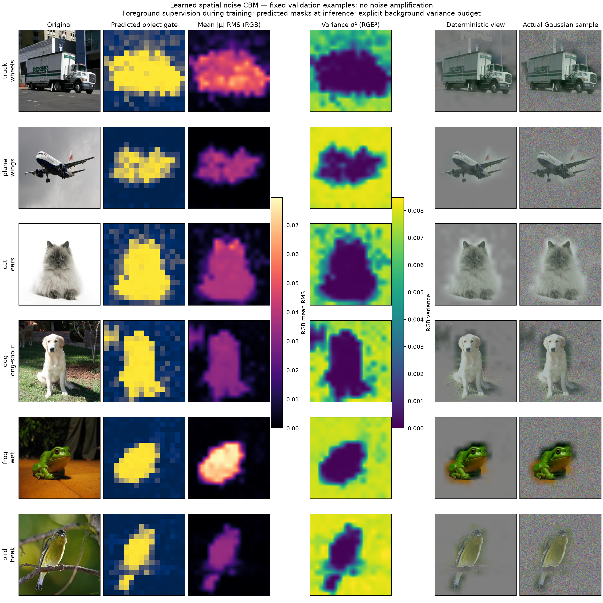

结论：全 2103 个有效验证样本的背景方差/主体方差为 6.73，主体 μ/背景 μ 为 4.89。概念部位 μ 与主体其他部位之比仅为 1.13，尚需改善细粒度定位。

主体区域由带监督的 ViT/text 模型预测；高背景 σ 和前景 μ 保护包含显式结构先验。μ 表示主体门控之后的概念均值偏移；相对原图的总均值变化还包括背景抑制。图形证明实际机制实现，不证明这些区域是原始 PiNI 分类 CE 自发发现的，也不能单独证明随机噪声带来性能收益。

## 随机噪声的增量作用

independent：分别训练的 μ+σξ − μ-only 为 -0.908 个百分点，配对 bootstrap 95% CI [-1.324, -0.473]。同样主体抑制和初始化，随机部分的收益必须由这组比较支持。

sequential：分别训练的 μ+σξ − μ-only 为 +0.605 个百分点，配对 bootstrap 95% CI [+0.378, +0.870]。同样主体抑制和初始化，随机部分的收益必须由这组比较支持。

local：分别训练的 μ+σξ − μ-only 为 -0.605 个百分点，配对 bootstrap 95% CI [-0.908, -0.303]。同样主体抑制和初始化，随机部分的收益必须由这组比较支持。

full_joint：分别训练的 μ+σξ − μ-only 为 -0.341 个百分点，配对 bootstrap 95% CI [-0.605, -0.057]。同样主体抑制和初始化，随机部分的收益必须由这组比较支持。

region：分别训练的 μ+σξ − μ-only 为 -0.435 个百分点，配对 bootstrap 95% CI [-0.719, -0.170]。同样主体抑制和初始化，随机部分的收益必须由这组比较支持。

noise_independent 同一检查点 MC1 − 均值推理为 -0.416 个百分点；这是推理诊断，不代替分别训练的均值对照。

noise_sequential 同一检查点 MC1 − 均值推理为 +0.170 个百分点；这是推理诊断，不代替分别训练的均值对照。

noise_joint 同一检查点 MC1 − 均值推理为 +0.284 个百分点；这是推理诊断，不代替分别训练的均值对照。

noise_separate_heads 同一检查点 MC1 − 均值推理为 -0.019 个百分点；这是推理诊断，不代替分别训练的均值对照。

local_noise 同一检查点 MC1 − 均值推理为 -0.643 个百分点；这是推理诊断，不代替分别训练的均值对照。

full_joint_noise 同一检查点 MC1 − 均值推理为 -0.416 个百分点；这是推理诊断，不代替分别训练的均值对照。

region_noise 同一检查点 MC1 − 均值推理为 -0.473 个百分点；这是推理诊断，不代替分别训练的均值对照。

fixed_noise 同一检查点 MC1 − 均值推理为 -0.322 个百分点；这是推理诊断，不代替分别训练的均值对照。

固定 0.5 阈值的精确率提升可能来自召回率下降。以下阈值只由验证集正样本的第 10 百分位确定，以目标召回率 90% 比较：

| 方法 | 测试宏精确率 | 测试宏召回率 |
|---|---:|---:|
| clean | 85.27% | 89.58% |
| local_clean | 85.33% | 88.95% |
| mean_independent | 84.53% | 89.36% |
| noise_independent | 83.91% | 89.50% |
| mask_sequential | 84.90% | 88.97% |
| mean_sequential | 84.89% | 88.97% |
| noise_sequential | 85.24% | 88.51% |
| noise_joint | 85.03% | 89.06% |
| mean_separate_heads | 85.00% | 88.90% |
| noise_separate_heads | 84.87% | 88.98% |
| local_mean | 84.80% | 89.74% |
| local_noise | 84.27% | 89.80% |
| full_joint_mean | 84.75% | 89.49% |
| full_joint_noise | 84.44% | 89.42% |
| region_clean | 83.92% | 89.63% |
| region_mean | 84.19% | 89.60% |
| region_noise | 84.03% | 89.15% |
| fixed_mean | 84.16% | 89.73% |
| fixed_noise | 84.18% | 89.92% |

不同模型的测试召回率仍可能不同，需同时读取这两列；逐概念 AP 和阈值见 `reports/spatial_noise_v1/concept_audit.json`。

## 背景互换实验

目的：将主体像素保留、移植异类图像背景，并先移除供体主体；真值掩膜仅构造外部干预，不作为 learned 模型推理输入。

| 方法 | 原图分类准确率 | 换背景分类准确率 | 换背景概念 mAP |
|---|---:|---:|---:|
| clean | 98.30% | 92.30% | 88.24% |
| mask_sequential | 99.00% | 94.90% | 89.79% |
| mean_sequential | 98.10% | 95.20% | 89.63% |
| noise_sequential | 98.90% | 94.70% | 89.38% |
| noise_sequential_same_checkpoint_mean | 98.70% | 93.90% | 89.19% |

固定分层测试子集 N=1000；配对差值与区间保存在 `artifacts/background_intervention/results.json`。需同时比较 noise 和 same-checkpoint mean，不能将主体门控效应全部归给随机采样。

## 为什么 PiNI 可能有效

图像 CNN 将每张图每个通道 μ、σ 的 RMS 固定为 0.1，避免方差直接收缩到零。对平滑分类损失，局部近似 E[L(x+μ+σξ)]≈L(x+μ)+½∑σ²·Hii；固定噪声预算促使方差移向损失曲率较小的区域，均值承担适配。这是可验证的机制假说，曲率小不必然等同背景。

主方法在全局视觉特征和文本提示嵌入上联合加噪，与 Figure 4 的图像 CNN 属于不同实验。论文 OxfordPets 图像 CNN 89.51%，主方法 92.97%，zero-shot 89.13%。主方法较大增益不能全部归因图像背景屏蔽。[论文](https://arxiv.org/abs/2412.10817)，[官方代码](https://github.com/hyzhang98/PiNI)。

高方差加性噪声降低背景信噪比，但不会使背景的像素期望自动消失；本变体显式增加预测主体门控，再比较同门控的 mean-only 和 Gaussian 模型。官方历史绘图使用了不同的反归一化参数，且 uint8 热图乘 256 溢出；新图使用正确 RGB 还原和物理色标。

## 官方复现进度

main：OxfordPets 16-shot、200 epochs、seed 1；MC1 89.26%，MC8 91.50%，同骨干 zero-shot 89.13%。

image：OxfordPets 16-shot、200 epochs、seed 1；MC1 89.29%，MC8 89.51%，同骨干 zero-shot 89.13%。

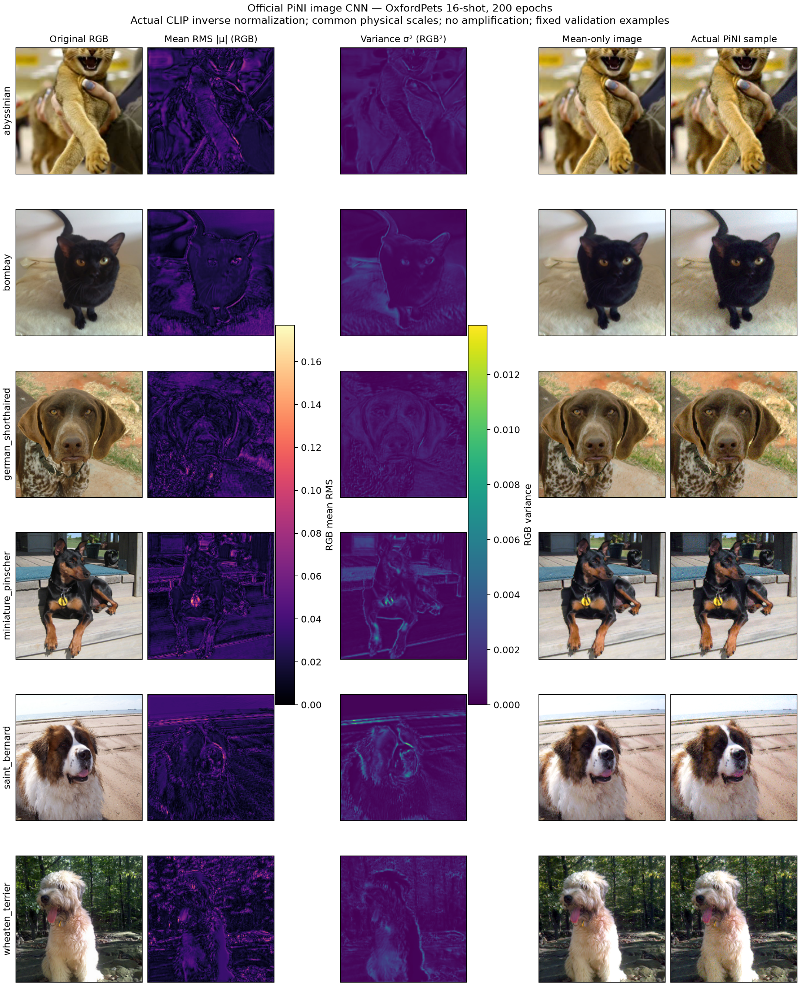

目的：检查原始 CE/RMS 约束是否自身产生背景高方差和主体均值，未使用区域监督。该图与新增带掩膜监督的 CBM 图分开解释。

官方神经网络类由原始源码 AST 无修改加载，冻结 CLIP，只训练原始生成器。Pets 专用 LR 和论文 split 文件未公开，本次固定 LR=0.002 并使用官方划分算法 seed 1；不宣称匹配作者未公开配置或三种子均值。

## 仍待完成

V1 对照：region_seed43_mean, region_seed43_noise

V1 joint 采用单概念真实视图、其他 17 个当前干净概念概率作为 detach 锚的近似；full_joint 分类前向使用全部 18 张实际概念视图。细粒度 V2、MC 稳定性与机制归因以对应完成记录为准；不能只用图像外观判断完成。

训练可用原生概念和主体掩膜；推理没有真值掩膜。缺失的 39 张主体掩膜不参与对应定位损失/指标。所有性能数字来自固定测试集；当前属于单划分单种子探索实验，尚无跨数据集或多种子确认。

运行协议见 [RESEARCH_PROTOCOL.md](RESEARCH_PROTOCOL.md)。真实缓存、完整预测、checkpoint 和日志保存在本机 ignored `artifacts/`，图表及简要结论入库。

## 配对不确定性与共享语义分类头

分类与全部 18 个原生概念的配对 bootstrap 结果见 [paired_uncertainty.json](reports/spatial_noise_v1/paired_uncertainty.json)。同时给出逐概念和覆盖全部概念的同步区间，避免只挑选改善项。该区间不包含训练种子变化。

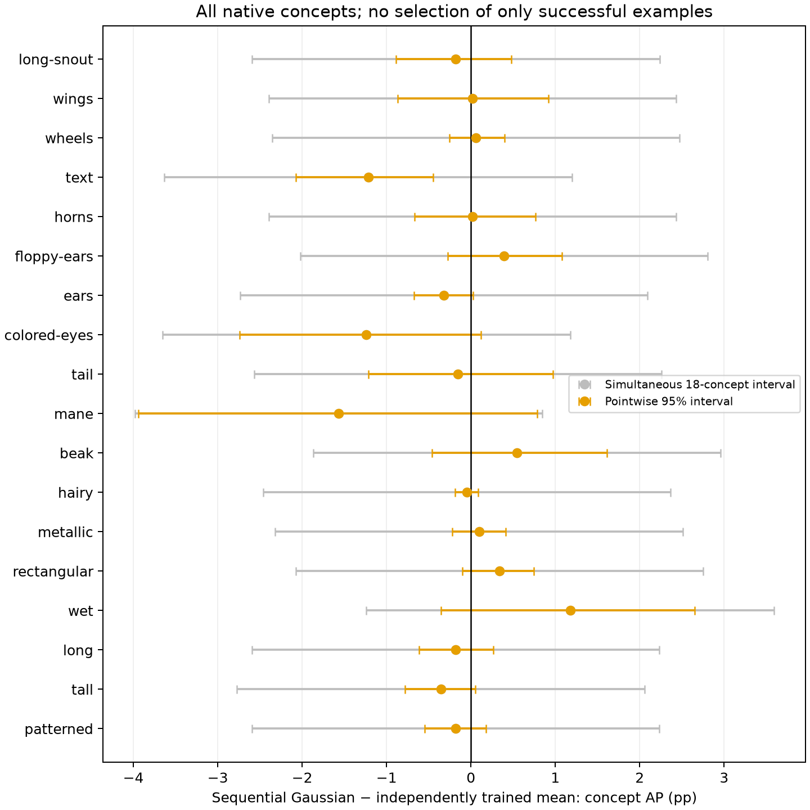

同一个仅由真值概念训练的稀疏分类头见 [semantic_readout.json](reports/spatial_noise_v1/semantic_readout.json)；它不利用分别拟合每个模型的置信度误差，仍不保证预测误差完全不携带类别。

完整联合分类图的真实 RGB 梯度检查保存在每个 full_joint 运行的 `class_gradient_audit.json`。现代 AMP 与原始 FP16/default test batch 是两套明确协议；精度与批次对原始提示噪声的抽样都有影响，不将不同协议之间的成绩差归因于单一因素。

## 补充机制与官方复验

RIVAL10：固定测试集 5,286 张，冻结 ViT-L/14，18 个原生概念，分类仅经过概念概率与稀疏线性头。推理不使用真值掩膜。NEC 是每类别非零概念连接数；不包含噪声生成器参数。固定划分和同一干净预训练初始化；适配 seed 43 复验若已完成则单独报告，不等同端到端多种子。

## 1. 分类与概念识别

**目的：**比较独立、顺序、抽样联合、完整联合训练，以及逐概念输出头；用相同初始化、训练视图预算和分类头选择规则检验噪声。

| 方法 | 分类准确率 | NEC | 概念 mAP |
|---|---:|---:|---:|
| clean matched head | 99.02% | 4.5 | 91.19% |
| mean_independent | 98.15% | 4.8 | 91.00% |
| noise_independent | 97.24% | 5.2 | 90.58% |
| mask_sequential | 98.79% | 4.4 | 91.21% |
| mean_sequential | 98.69% | 4.4 | 91.22% |
| noise_sequential | 99.30% | 4.2 | 91.07% |
| noise_joint | 99.00% | 4.2 | 91.16% |
| mean_separate_heads | 98.96% | 4.4 | 91.32% |
| noise_separate_heads | 99.05% | 4.3 | 91.14% |
| local_mean | 99.13% | 4.5 | 90.81% |
| local_noise | 98.52% | 4.4 | 90.30% |
| full_joint_mean | 99.24% | 4.1 | 90.72% |
| full_joint_noise | 98.90% | 3.9 | 90.40% |
| region_mean | 99.05% | 4.4 | 89.68% |
| region_noise | 98.62% | 4.5 | 89.29% |
| fixed_mean | 99.15% | 4.4 | 89.72% |
| fixed_noise | 98.71% | 4.3 | 89.40% |
| local clean matched head | 99.45% | 4.3 | 90.65% |
| region clean matched head | 99.32% | 4.3 | 89.64% |

语义信息检查：同一组真值二元概念在 70 种配置中对应多个类别；在当前测试样本上，仅用这 18 个真值二元概念的确定性分类上限为 93.40%（不可避免 349 个冲突）。这是测试标签重叠诊断，不是测试拟合模型，也不约束真实连续概念强度。99% 分类不能单独证明概念更准确，应同时检查 native AP、校准精确率和预测二值化结果。

**本次结果：**顺序训练 μ+σξ 比分别训练的 μ-only 分类高 0.61 个百分点，配对 95% CI [0.38, 0.87]；概念 mAP 差为 -0.16，CI [-0.38, +0.08]，尚无整体概念识别提升证据。

使用同一个、仅由真值概念训练的分类头，增益仍为 +0.36 个百分点，CI [+0.06, +0.64]，说明收益不完全依赖分别拟合分类头。

训练/推理拆分：随机训练模型改用均值推理，仍比 μ-only 训练高 +0.44 pp，CI [+0.19, +0.70]；同检查点单次随机采样比均值高 +0.17 pp，CI [-0.02, +0.38]。这区分训练中的适配/正则化与推理中的随机扰动。

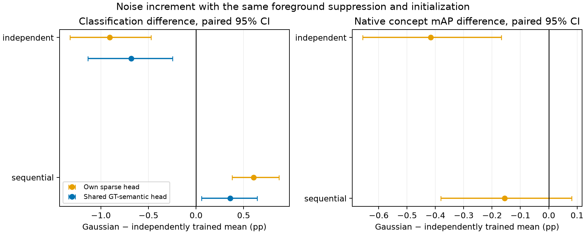

local_noise_minus_local_mean：分类差 -0.61 pp，CI [-0.91, -0.30]；概念 mAP 差 -0.51 pp，CI [-0.77, -0.26]。

full_joint_noise_minus_full_joint_mean：分类差 -0.34 pp，CI [-0.61, -0.06]；概念 mAP 差 -0.32 pp，CI [-0.56, -0.12]。

region_noise_minus_region_mean：分类差 -0.44 pp，CI [-0.72, -0.17]；概念 mAP 差 -0.39 pp，CI [-0.68, -0.11]。

noise_separate_heads_minus_mean_separate_heads：分类差 +0.09 pp，CI [-0.17, +0.36]；概念 mAP 差 -0.19 pp，CI [-0.40, +0.04]。

fixed_noise_minus_fixed_mean：分类差 -0.44 pp，CI [-0.72, -0.15]；概念 mAP 差 -0.31 pp，CI [-0.55, -0.06]。

局部区域监督本身：正概念区域 IoU 从 35.07% 提高到 51.52%，概念 mAP 从 91.19% 变为 90.65%。这些变化发生在加噪前，应与后续随机生成器收益分开。

定位与识别的路径检查：将已经训练好的概念头分解为 CLS 和区域聚合两项，分别测量排序能力。这是冻结权重的贡献诊断，不是重新训练的独立模型。局部掩膜更准并不保证识别真的依赖那个区域。

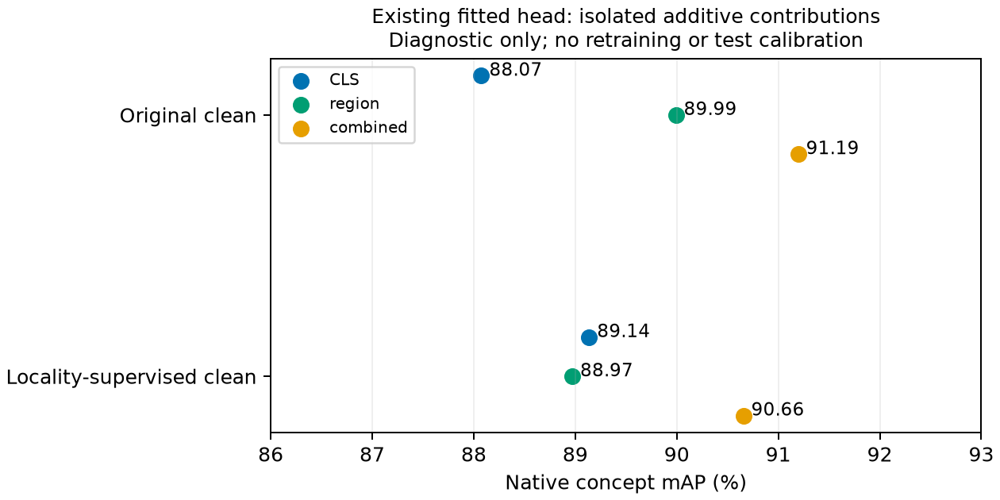

**采样稳定性：**按验证概念 mAP 选配置，再用原分类头评估八次采样均值，测试不参与选择。

| 验证选择的随机模型 | MC1 分类 | MC8 分类 | MC8 概念 mAP | 同检查点 μ 分类 |
|---|---:|---:|---:|---:|
| noise_separate_heads | 99.05% | 99.19% | 91.27% | 99.07% |
| full_joint_noise | 98.90% | 99.21% | 90.51% | 99.32% |

共享生成器与逐概念输出头容量不同；逐概念噪声必须与同容量 mean_separate_heads 比较，同检查点 μ 只用于推理诊断。

## 2. 是否减少背景干扰

**目的：**保留主体像素、移植异类背景并移除供体主体。真值掩膜仅构造外部干预，模型重新从换背景图像预测所有区域。

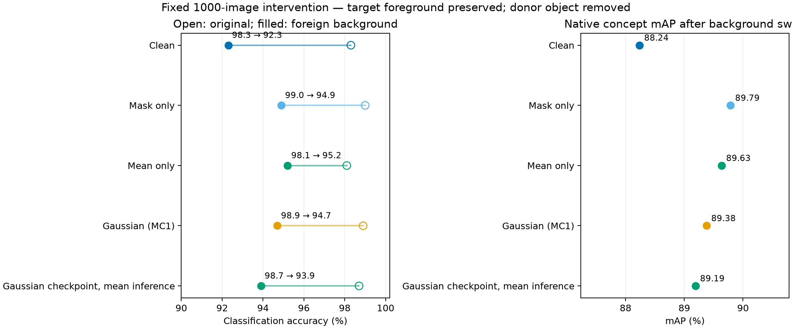

**结论：**主体屏蔽提高换背景后的分类与概念识别；当前顺序加噪 94.7%，μ-only 95.2%，未证实随机噪声额外提高抗背景干扰能力。

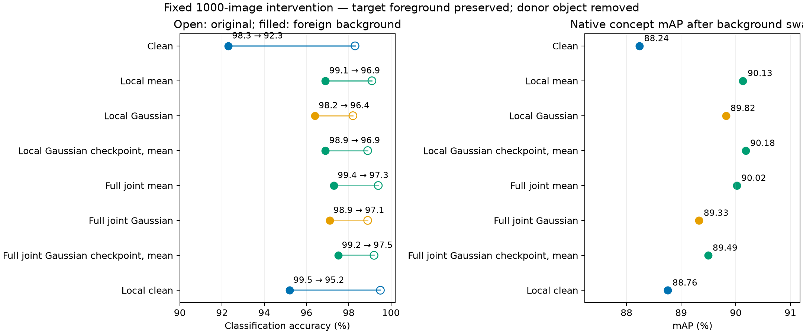

| 匹配随机对照 | 换背景后分类差（噪声 − μ-only） | 配对 95% CI |
|---|---:|---:|
| local_noise_minus_local_mean_background_swap | -0.50 pp | [-1.60, +0.60] |
| full_joint_noise_minus_full_joint_mean_background_swap | -0.20 pp | [-1.10, +0.60] |

局部与完整联合对照在同一批 1,000 张图、相同供体背景上评估；读数以实际配对区间为准。

相对更强的局部干净基线，local_noise_minus_local_clean 换背景分类差 +1.20 pp，CI [+0.00, +2.40]。

相对更强的局部干净基线，full_joint_noise_minus_local_clean 换背景分类差 +1.90 pp，CI [+0.80, +3.00]。

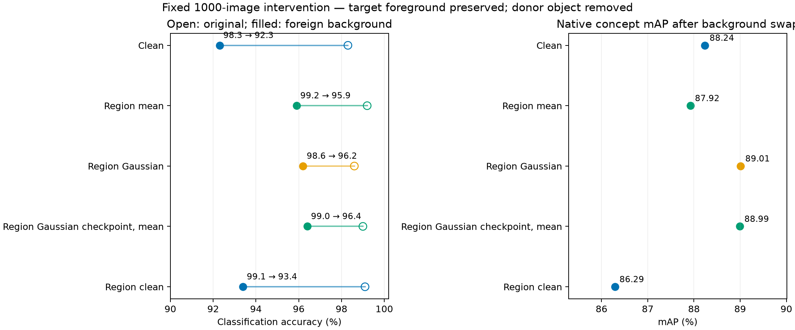

区域识别：换背景后噪声 − μ-only 分类差 +0.30 pp，CI [-0.80, +1.40]。

区域识别：相对自身干净基线，换背景分类差 +2.80 pp，CI [+1.40, +4.30]。完整加噪流程与随机项的贡献需分别读取这两组比较。

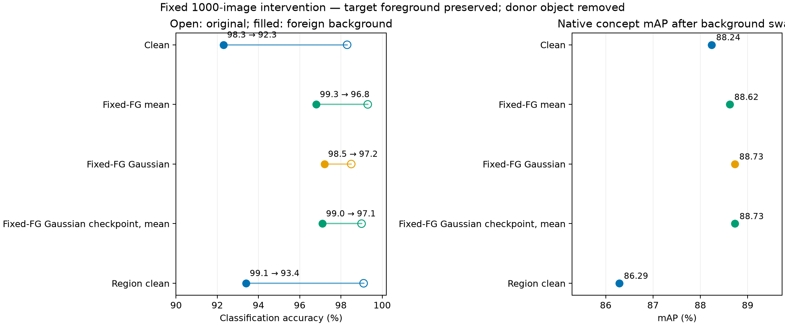

fixed_noise_minus_fixed_mean_background_swap：分类差 +0.40 pp，CI [-0.40, +1.10]。

fixed_noise_minus_fixed_noise_same_checkpoint_mean_background_swap：分类差 +0.10 pp，CI [-0.60, +0.90]。

## 3. 真实噪声是否形成预期空间分布

**目的：**展示未经放大的实际 μ、σ² 和采样图，检验主体均值与背景方差；同一图像不同概念另外比较。

图中模型：`artifacts/noise_separate_heads`；训练方式比较阶段按六个配置的完整验证概念 mAP 选择，阶段图库完成前展示指定顺序配置。区域读出版本单独展示。

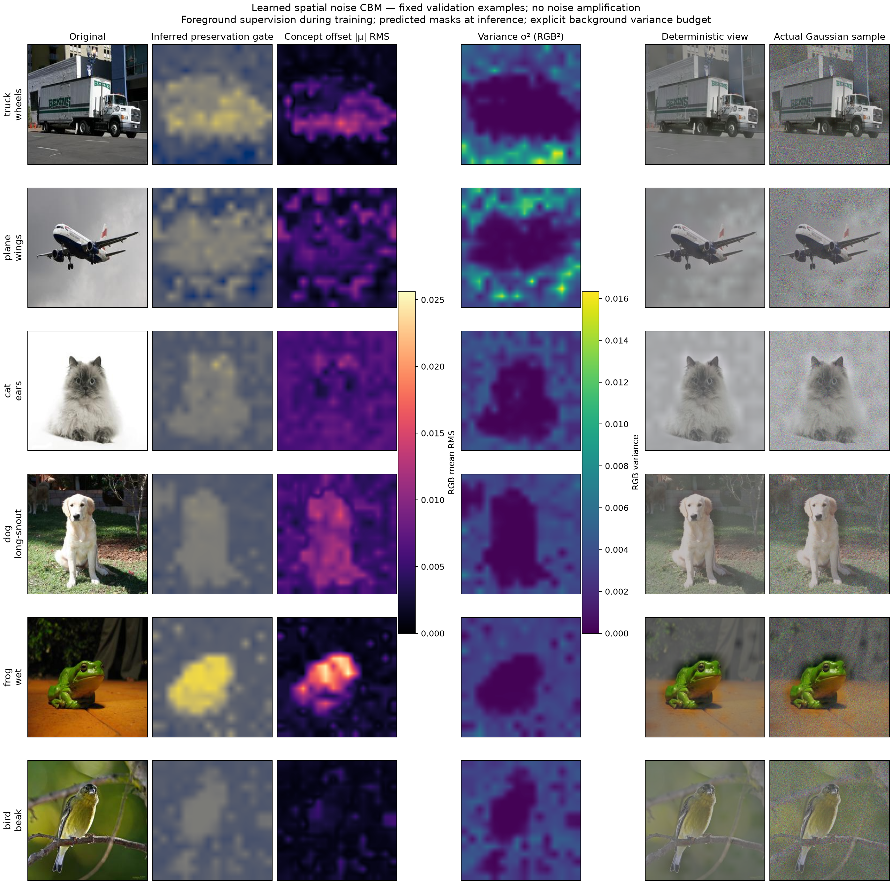

**结论：**全 2103 个有效验证样本，背景方差/主体方差 5.55，主体 μ/背景 μ 1.60；概念部位 μ/主体其他部位 1.13。这些能量比只描述扰动分布，不能代替主体屏蔽正确性或概念识别指标。

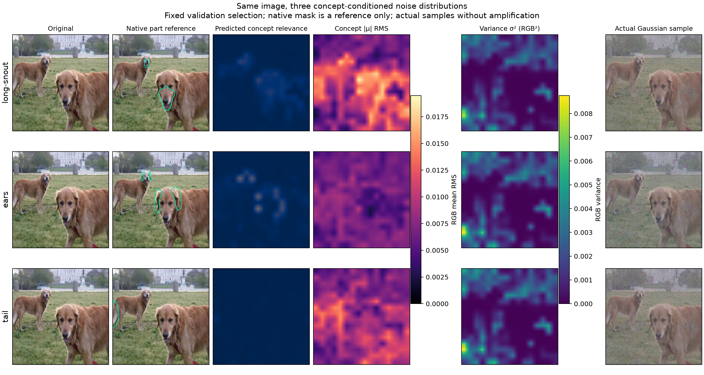

区域读出版本：概念概率由预测主体×概念区域的 CLIP patch 聚合计算，直接 CLS 特征读出关闭；μ 使用预测区域内固定 RMS 预算 0.02686 RGB（由 PiNI 的 0.1 CLIP 单位换算，训练前固定）。这同时改变读出结构和 μ 约束，应与它自己的 region_mean 对照比较。

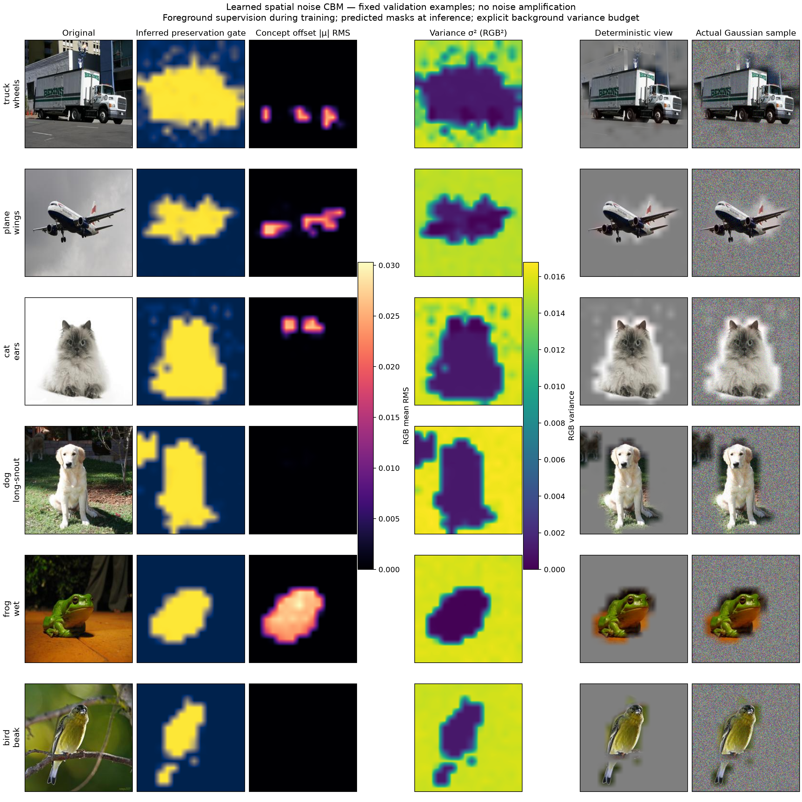

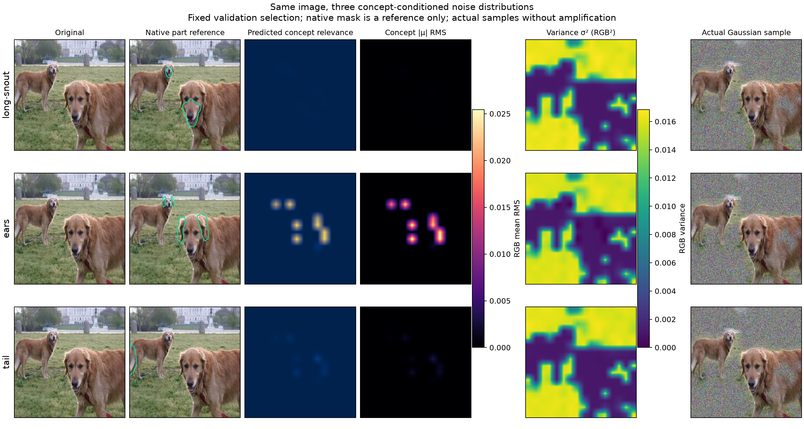

主体屏蔽漂移：顺序随机模型的验证主体 IoU 从 73.19% 降为 37.66%，真实背景上平均前景概率 73.27%。提高前景概率会降低该处 σ，所以分类目标可能通过扩大前景区减弱噪声。这解释了为何漂亮的方差比不能证明背景被正确屏蔽。

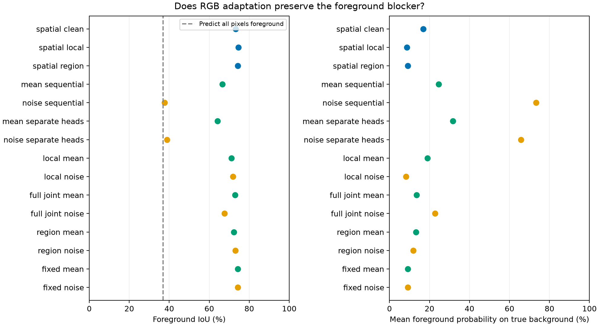

冻结屏蔽器版本：独立的预训练主体预测器保持冻结，预测主体同时约束 RGB 和原生概念区域读出；18 个概念分别输出 μ/σ。σ 的全图 RGB RMS 固定为 0.02686。主体权重变化 0.0、固定验证主体概率变化 0.0，不能通过重标背景来降低扰动。

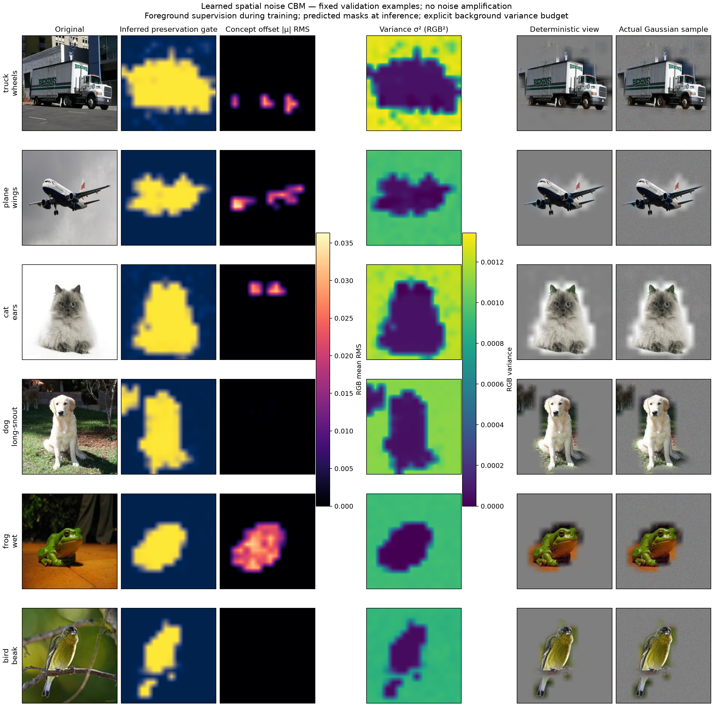

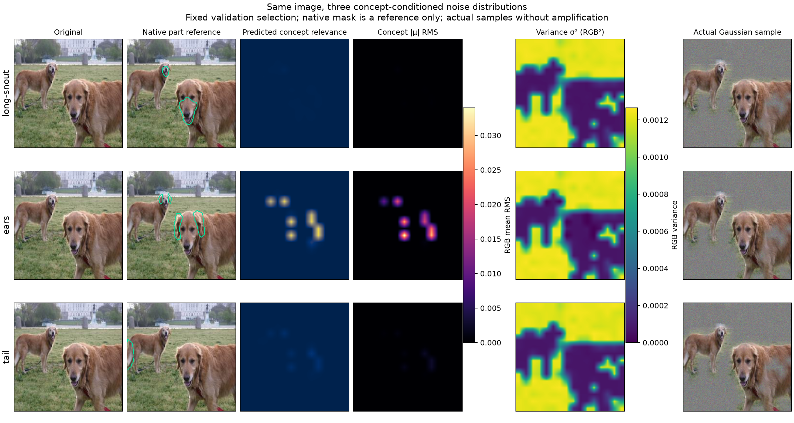

冻结主体全 2103 张有效验证图：背景/主体方差 5.67，主体/背景 μ 14.32。这些是实际 RGB 能量分布，包含显式空间先验。

全部 9022 个正概念/图像对，原始概念区域 IoU 47.31%；实际主体×概念读出区域 IoU 47.17%。其中 4080 个局部部位的 μ/主体其他部分为 12.21。

区域监督、主体保护和背景 σ 下限是新增方法的显式约束。μ 是门控后的偏移，总均值变化还包括背景衰减。视觉效果本身不能证明随机噪声收益。

额外检查背景噪声是否仍影响识别：用同一个随机样本分别只扰动前景、只扰动背景、扰动全图。真值主体仅构造外部诊断；学习的生成器保持原输入。

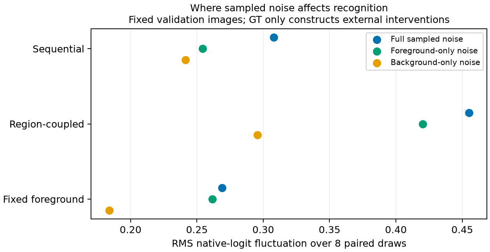

noise_sequential：固定 60 张验证图、全部 18 个概念、8 次配对采样；背景/前景单独扰动引起的原生 logit 方差比 0.90。该比值同时受注入能量和模型敏感性影响，不是测试准确率；高背景 σ 本身不保证识别忽略背景。

region_noise：固定 60 张验证图、全部 18 个概念、8 次配对采样；背景/前景单独扰动引起的原生 logit 方差比 0.50。该比值同时受注入能量和模型敏感性影响，不是测试准确率；高背景 σ 本身不保证识别忽略背景。

fixed_noise：固定 60 张验证图、全部 18 个概念、8 次配对采样；背景/前景单独扰动引起的原生 logit 方差比 0.49。该比值同时受注入能量和模型敏感性影响，不是测试准确率；高背景 σ 本身不保证识别忽略背景。

## 4. 官方 PiNI 复现

**目的：**用官方原始模型类分别复验主方法与 Figure 4 的图像 CNN；OxfordPets 16-shot，200 轮，seed 1，完整 3,669 张测试。

| 方法 / 精度协议 | MC1 | MC8 | 同检查点 μ | 论文 |
|---|---:|---:|---:|---:|
| main · AMP / test batch 128 | 89.26% | 91.50% | 90.68% | 92.97% |
| main · 原始 FP16 / test batch 32 | 88.83% | 91.91% | 88.09% | 92.97% |
| image · AMP / test batch 128 | 89.29% | 89.51% | 88.66% | 89.51% |
| image · 原始 FP16 / test batch 32 | 89.40% | 89.40% | 88.85% | 89.51% |

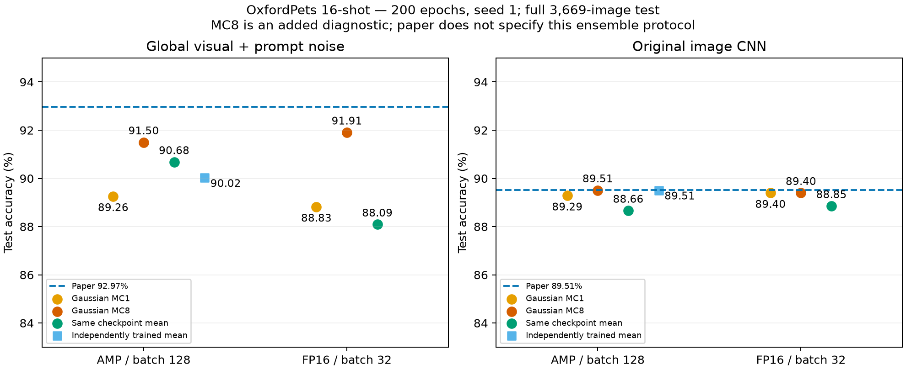

main AMP：随机 MC8 − 分别训练的 μ-only 为 +1.47 pp，配对 CI [+0.68, +2.29]。

image AMP：随机 MC8 − 分别训练的 μ-only 为 +0.00 pp，配对 CI [-0.71, +0.71]。

为什么主方法看起来收益较大：本次 AMP 主方法八次采样比单次高 +2.23 pp，CI [+1.39, +3.08]；单次随机预测比独立 μ-only 为 -0.76 pp，CI [-1.74, +0.25]。当前最明确的收益包含采样平均，不能全部归因单次加噪，更不能归因图像背景屏蔽。视觉特征与提示扰动的各自贡献尚未分离。

**结论：**原始图像 CNN 的 AMP MC8 为 89.51%，数值上接近论文；主方法仍有复现差距。MC8 是新增诊断，不能等同论文未明确的采样协议。Pets 专用 LR 和论文 split 文件未公开，本次固定 LR=0.002，不依据测试调参。

原始 CNN 的 AMP 训练权重，全 147 个有效验证样本：背景方差/主体方差 1.13，主体 μ/背景 μ 0.94。本次 AMP 复验没有稳定产生理想的主体/背景分离；原分类 CE 和固定 RMS 不保证这种模式。见[校正后的 AMP CNN 图](reports/pini_official/figure4_official.png)。

原始默认 FP16 训练及实际 FP16 前向，全 147 个有效验证样本：背景方差/主体方差 1.07，主体 μ/背景 μ 0.99。对应[FP16 真实 CNN 图](reports/pini_official/fp16/figure4_official.png)，与 AMP 版本分开评估。

主方法在全局视觉特征和文本提示上联合加噪，Figure 4 属于单独的 RGB CNN 实验。其较大分类增益不能全部解释为图像背景屏蔽。[论文](https://arxiv.org/abs/2412.10817)，[官方代码](https://github.com/hyzhang98/PiNI)。

LF-Pi 的先前大幅增益也需要分离训练适配与随机项：匹配 CIFAR-10 全局对照中，确定性均值 88.44%、随机 MC8 88.42%，NEC 分别 21.5 与 21.9；这支持“任务投影/均值适配压缩了分类所需连接”，未证明背景随机屏蔽。真实图像、人工概念与背景干预见 [LF-Pi 机制报告](https://github.com/Dodocheshire/LF-Pi/blob/main/NOISE_MECHANISM_REPORT.md)。

## 5. 当前状态与完整记录

待完成：region_seed43_mean, region_seed43_noise。

抽样 joint 用一张真实概念视图和其余 17 个 detach 干净锚；full_joint 用全部 18 张真实视图回传分类损失，两者明确区分。完整联合采用相同 36,018 个梯度视图预算，但源图覆盖不同。

逐概念 AP、校准精确率/召回率、置信区间及语义瓶颈检查见[详细报告](EXPERIMENT_REPORT.md)、[逐概念审计](reports/spatial_noise_v1/concept_audit.json)与[协议](RESEARCH_PROTOCOL.md)。所有负结果一并保留；原始预测、真实 RGB 张量与 checkpoint 在本机 `artifacts/`。
