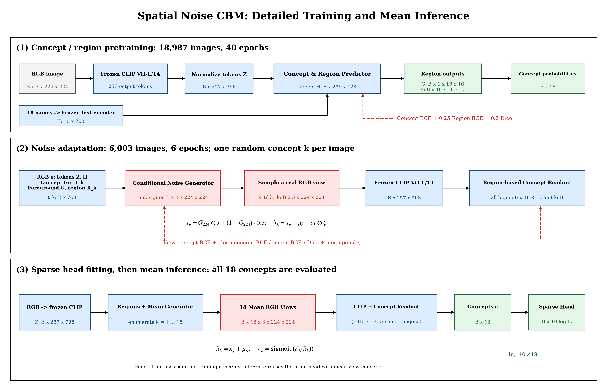
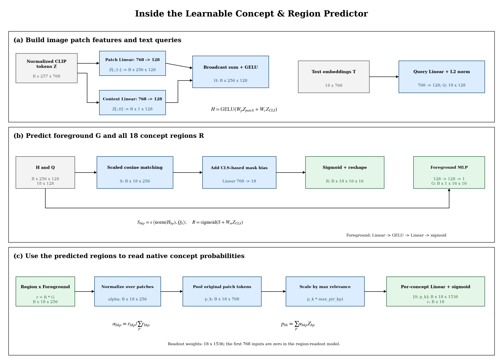
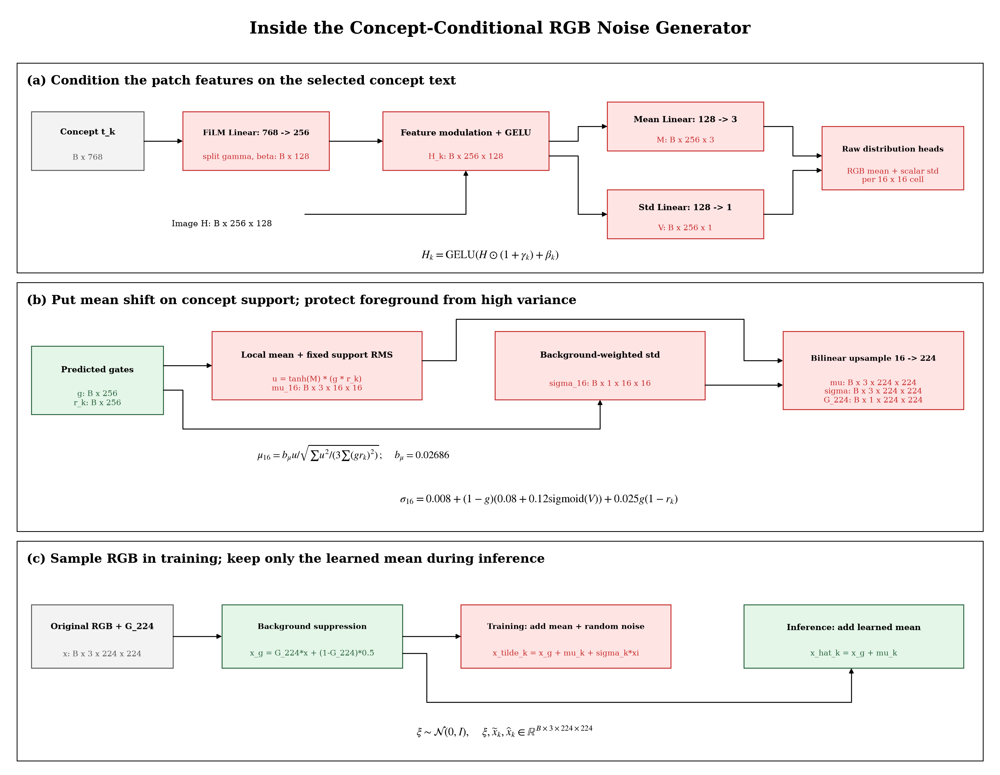
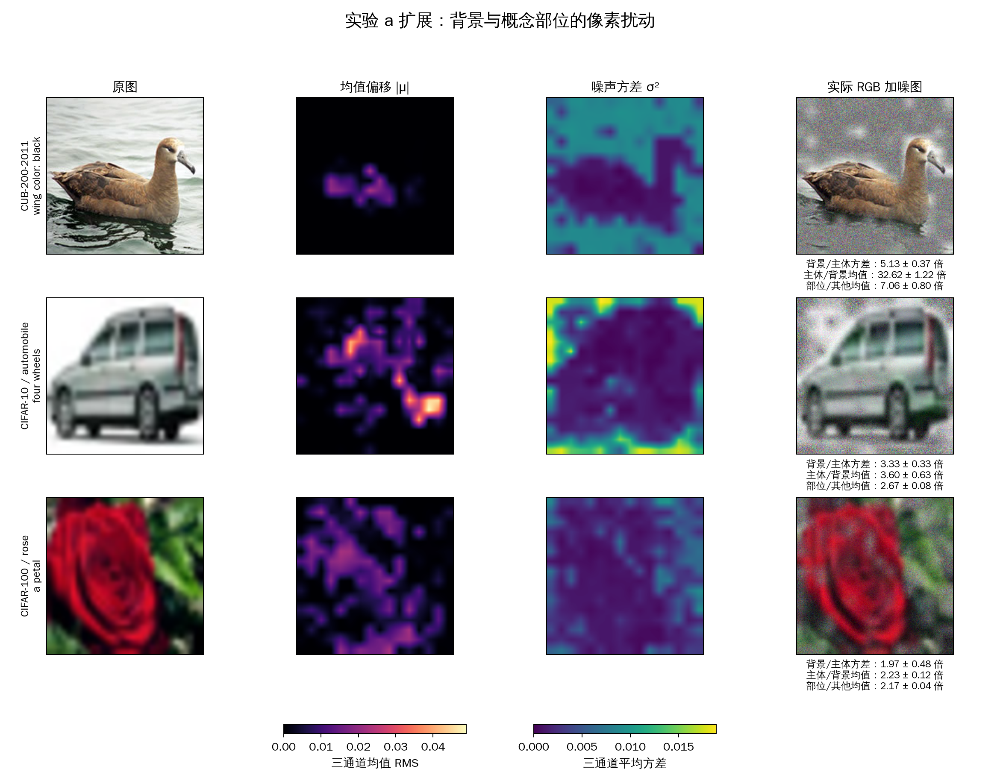
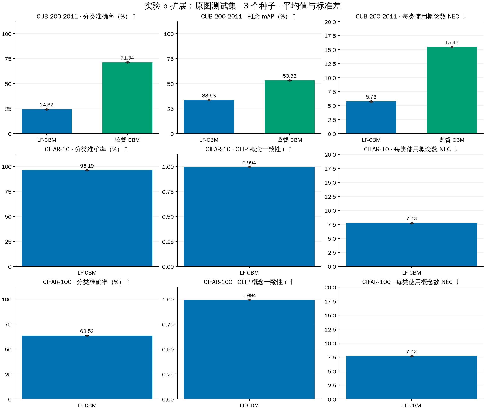
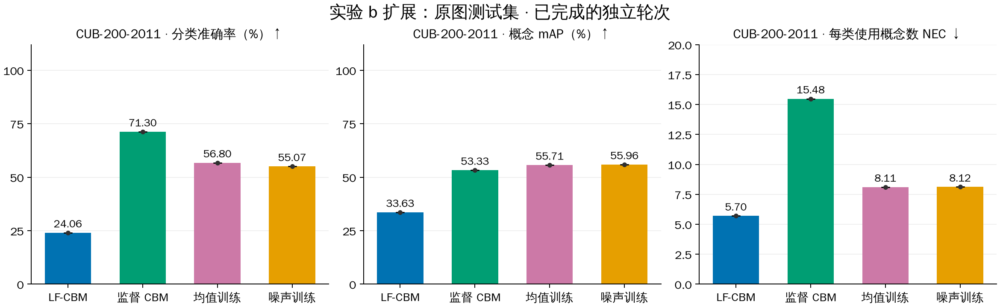
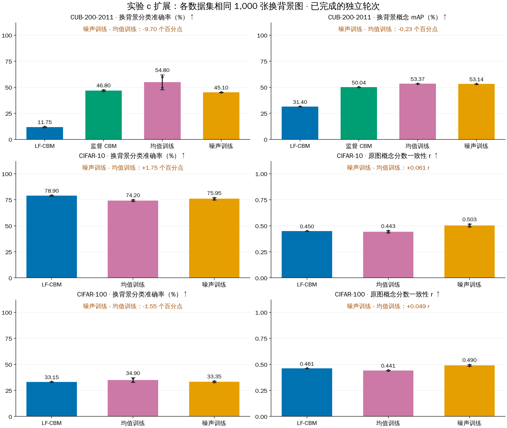

# Spatial Noise CBM：基于概念区域的 RGB 加噪

## Abstract

为了让概念识别更多关注主体部位，我们构建了一个受 PiNI 启发的空间加噪 CBM：先学习主体和概念区域，再在 RGB 像素上学习概念对应的高斯噪声，最后通过 18 个概念完成分类。背景承受更强的随机扰动，概念部位得到更集中的均值偏移。使用 RIVAL10 和冻结的 CLIP ViT-L/14，三轮适配后按均值推理，原图分类准确率为 **99.12%**，NEC 为 **4.43**。在同一组换背景图片上，相对只学习均值，训练加噪使分类提高 **1.03 个百分点**、概念 mAP 提高 **0.91 个百分点**；相对监督 CBM，换背景分类高 **4.13 个百分点**、概念 mAP 高 **3.73 个百分点**。

## Background（为什么要做）

概念瓶颈模型先识别“车轮、机翼、耳朵”等概念，再用这些概念判断图片类别。如果模型把道路当成车轮的线索、把天空当成机翼的线索，换个背景就可能认错。我们希望直接改变模型看到的图片：弱化背景，让概念识别关注相应部位。[Concept Bottleneck Models](https://proceedings.mlr.press/v119/koh20a.html) 提供了“图像→概念→类别”的基本路径；[LF-CBM](https://arxiv.org/abs/2304.06129) 用视觉语言模型的概念分数训练投影；[PiNI](https://arxiv.org/abs/2412.10817) 提供了学习有益噪声分布的思路。

本文将这些思路组合成空间加噪 CBM：用概念和区域监督学习定位，再让噪声生成器随图片和概念变化。区域门控负责“改哪里”，学习到的均值和标准差负责“怎么改、改多少”。

## 原理与方法

### 1. 详细 Pipeline 与张量形状

**图 1 注释。** 三行分别表示区域预训练、像素噪声适配和分类头拟合后的均值推理。蓝色表示编码与概念模块，红色表示噪声及训练损失，绿色表示区域、概念概率和分类输出；黑色实线表示前向计算，红色虚线表示训练反馈。$B$ 是图片批量，$k$ 是当前要识别的概念。训练时每张图片随机取一个 $k$，一次送入 ViT 的处理图片为 $B$ 张；推理时遍历 18 个概念，处理图片展平为 $18B$ 张，并从每张图的 18 个输出中取对应概念的那一项。原来的[简版 Pipeline](reports/main/pipeline.png)保留供快速查看。

| 张量 | 形状 | 人话解释 |
|---|---|---|
| 原始 RGB 图片 $x$ | $B\times3\times224\times224$ | 输入图片 |
| CLIP 输出 $Z$ | $B\times257\times768$ | 1 个 CLS token 和 $16\times16$ 个 patch token |
| 概念文本 $T$ | $18\times768$ | 18 个概念名称的固定向量 |
| 图像隐藏特征 $H$ | $B\times256\times128$ | 每个 patch 的可学习特征 |
| 文本查询 $Q$ | $18\times128$ | 每个概念用于匹配图像 patch 的向量 |
| 主体概率 $G$ | $B\times1\times16\times16$ | 每个位置属于主体的概率 |
| 概念区域概率 $R$ | $B\times18\times16\times16$ | 每个位置属于各概念区域的概率 |
| RGB 均值、标准差 $\mu_k,\sigma_k$ | 各为 $B\times3\times224\times224$ | 对当前概念生成的像素扰动参数 |
| 18 张均值视图 | $B\times18\times3\times224\times224$ | 同一张原图针对不同概念分别处理 |
| 概念概率 $c$ | $B\times18$ | 分类所用的 18 个概念值 |
| 分类权重、类别 logits | $10\times18$、$B\times10$ | 用概念预测 10 个类别 |

**表 1 注释。** ViT-L/14 的 patch 大小为 $14\times14$，224 像素图片对应 $16\times16$ 网格。表中的 768 是 CLIP 投影后的输出维度。张量形状已用实际权重前向检查，记录见 [tensor_shapes.json](reports/main/tensor_shapes.json)。

### 2. Learnable Concept & Region Predictor 如何工作

**图 2 注释。** 上行将 patch token 与 CLS 上下文分别线性映射到 128 维，相加并经过 GELU，得到 $H$；概念文本也投影到 128 维，得到查询 $Q$。中行用 $H$ 与 $Q$ 的余弦匹配预测 18 张概念区域图，加入由 CLS 预测的概念偏置；另一条 MLP 分支预测主体概率 $G$。下行将概念区域与主体概率相乘，在 patch 维度归一化后加权汇聚原始 patch token，并按区域最大置信度缩放，最后逐概念输出概率。参数存储中的识别权重为 $18\times1536$；本模型输入为 $[0;p_k]$，其中 $p_k$ 为 768 维区域特征。

具体计算为：

$$
H=\operatorname{GELU}(W_p Z_{patch}+W_c Z_{CLS}),\qquad
Q=\operatorname{norm}(W_qT).
$$

$$
R_{bkp}=\operatorname{sigmoid}\!\left(s\langle\operatorname{norm}(H_{bp}),Q_k\rangle+(W_mZ_{CLS})_{bk}\right),\quad
G_{bp}=\operatorname{sigmoid}(\operatorname{MLP}_{fg}(H_{bp})).
$$

$$
r_{bkp}=R_{bkp}G_{bp},\quad
\alpha_{bkp}=\frac{r_{bkp}}{\sum_p r_{bkp}},\quad
p_{bk}=\left(\sum_p\alpha_{bkp}Z_{bp}\right)\max_p r_{bkp}.
$$

这样，识别“耳朵”的概念头主要汇聚预测耳朵区域的信息。区域很不确定时，最大置信度缩放也会减弱汇聚特征。

### 3. Concept-Conditional Noise Generator 如何工作

**图 3 注释。** 概念文本 $t_k$ 经一个 $768\to256$ 的线性层，拆成 128 维的缩放 $\gamma_k$ 和偏移 $\beta_k$；FiLM 调制让同一图片的隐藏特征随概念变化。均值分支为 $128\to3$，标准差分支为 $128\to1$，先在 $16\times16$ 网格生成参数。均值用主体与当前概念区域共同门控，再按相关区域的 RMS 归一化；标准差按背景概率分配更强扰动。双线性插值将参数放大到 $224\times224$；标准差在三个 RGB 通道广播，每个像素和通道独立采样。下行区分随机训练视图和确定性的均值推理视图。

$$
H_k=\operatorname{GELU}(H\odot(1+\gamma_k)+\beta_k),\qquad
M_k=W_\mu H_k,\quad V_k=W_\sigma H_k.
$$

在网格上，均值受 $G R_k$ 门控，相关区域的 RMS 预算为 $b_\mu=0.02686$；标准差为：

$$
\sigma_k=0.008+(1-G)\left(0.08+0.12\operatorname{sigmoid}(V_k)\right)+0.025G(1-R_k).
$$

这条公式给背景更强的随机扰动，并给主体中与当前概念无关的区域少量扰动。均值与标准差插值后，先按预测主体区域将背景向灰色弱化，再得到训练与推理图片：

$$
x_g=G_{224}\odot x+(1-G_{224})\cdot0.5,\qquad
\widetilde x_k=x_g+\mu_k+\sigma_k\odot\xi,\quad\xi\sim\mathcal N(0,I),\qquad
\widehat x_k=x_g+\mu_k.
$$

### 4. 如何训练与推理（RIVAL10 设置）

**第一阶段：学习概念与区域。** 冻结 CLIP，使用 18,987 张训练图训练区域模块 40 轮，用验证集选取第 17 轮权重。监督来自 18 个概念标签、主体标注和概念区域标注；损失为概念 BCE + 0.25 区域 BCE + 0.5 Dice。BCE 衡量概念或区域预测与标签是否一致，Dice 鼓励预测区域覆盖真实部位。

**第二阶段：学习像素噪声。** 从第一阶段权重出发，在固定的 6,003 张图上训练 6 轮。每张图随机选择一个概念，把处理后的 RGB 图片重新送入冻结的 ViT。概念识别损失更新噪声生成器及概念/区域模块，同时保留原图概念与区域监督。损失为处理图概念 BCE + 0.25 原图概念 BCE + 0.25 区域 BCE + 0.25 Dice + 0.005 均值平方惩罚。验证集的固定 498 张图用于选择适配权重。

**第三阶段：拟合分类头。** 固定前两部分，为每张训练图生成 18 个概念概率，标准化后拟合带 L1 正则的线性分类头。噪声组用一次随机采样得到的训练概念，均值组用均值视图的训练概念。L1 强度从 0.003、0.01、0.03、0.06、0.1 中按完整验证集选择，稀疏权重让每个类别只依赖少量概念。

**推理。** 输入一张 RGB 图片，预测主体和概念区域，为每个概念生成一张均值视图；每张视图经过 ViT 和概念识别器，取其对应的概念概率。拼成 18 维概念向量后，用已拟合的分类头输出类别。分类头权重为 $10\times18$。每张图片需要编码 1 张原图及 18 张概念视图；两个基线各编码 1 张原图。

### 5. CUB、CIFAR-10、CIFAR-100 的统一设置

以下扩展仍使用冻结的 **CLIP ViT-L/14** 和 $224\times224$ RGB 图片，加噪位置仍是 **RGB 像素**。每张图针对 $K$ 个概念生成 $K$ 张视图；噪声训练组和均值训练组测试时都使用均值视图。种子为 **42、43、44**。
图 1–3 和表 1 以 RIVAL10 的 18 个概念、10 个类别展开；以下三个数据集使用相同模块，概念张量中的 18 替换为 $K$，分类头输出维度采用各数据集的类别数。

| 数据集 | 类别数 | 概念数 K | 训练 / 验证 / 测试 | 概念和区域怎样得到 |
|---|---:|---:|---|---|
| CUB-200-2011 | 200 | 112 | 5,394 / 600 / 5,794 | 112 个原生逐图属性；主体分割图；15 个部位点生成局部区域 |
| CIFAR-10 | 10 | 64 | 45,000 / 5,000 / 10,000 | LF-CBM 概念文本；CLIP 概念软分数；SAM2 主体与 CLIP patch 概念区域 |
| CIFAR-100 | 100 | 128 | 45,000 / 5,000 / 10,000 | LF-CBM 概念文本；CLIP 概念软分数；SAM2 主体与 CLIP patch 概念区域 |

**表 6 注释。** 数据从本机已下载的副本拷贝。验证集从官方训练集按类别分层划分，比例 10%，划分种子 310；官方测试集用于最终评估。CUB 使用 [Koh 2020 公布的 112 个属性索引](https://github.com/yewsiang/ConceptBottleneck/blob/master/CUB/generate_new_data.py)，保留每张图自己的 0/1 属性标签。部位区域是以可见部位点为中心、半径为图像边长 9% 的圆，与主体分割图相交。

CIFAR 的 64 / 128 个概念从 LF-CBM 候选文本中，按训练集 CLIP 分数的“类别间方差 / 总方差”选出，类别名称本身不作为概念。概念目标是训练集标准化 CLIP 分数经过 sigmoid 得到的软分数。主体区域由冻结的 Grounding DINO 与 SAM2 生成：CLIP 先预测图像类别，Grounding DINO 据此生成检测框；SAM2 同时使用检测框和五个中心附近的提示点。以真实 RGB 主体图和背景图的 CLIP 分数差选择掩码，再合并重叠的同一主体区域。主体区域监督覆盖固定的 6,000 张训练图；概念区域由主体内 CLIP 文本匹配分数最高的 40% patch 生成。

区域预训练使用完整训练划分，共 40 轮。像素适配使用 CUB 的全部 5,394 张训练图、每个 CIFAR 的固定 6,000 张训练图，各训练 6 轮；固定 500 张验证图用于选择适配权重。噪声组在验证时采样随机扰动，均值组使用均值视图，各自按验证概念指标选择适配权重。分类头使用同一批适配训练图，完整验证集选取 L1 强度。L1 网格沿用 0.003、0.01、0.03、0.06、0.1，并乘以 $10/N$，$N$ 为类别数；从平均 NEC 不超过 16 的候选中选择验证准确率最高的分类头。

换背景使用各数据集固定的 1,000 张测试图。CUB 的背景来自验证集其他类别图片，供体主体先填成灰色。CIFAR 从供体的 SAM2 区域和检测框外截取纯背景片区，面积至少占原图 10%，放大到 224×224 后替换目标背景。每个数据集的图片、供体和背景片区在全部方法及三轮中固定。

LF-CBM 使用 CLS 特征与 CLIP 概念文本分数训练 cosine-cubed 投影。CUB 的监督 CBM 按 Koh 的顺序训练思路，先以 BCE 学习属性，再拟合稀疏分类头。CIFAR 使用 LF-CBM 对照。

## 主要实验和结果

RIVAL10 实验使用 [RIVAL10](https://github.com/mmoayeri/RIVAL10) 的 10 类、18 个原生概念和冻结的 CLIP ViT-L/14；输入统一缩放到 $224\times224$。训练/验证/测试分别为 **18,987 / 2,111 / 5,286** 张。空间加噪和均值训练从同一区域预训练权重出发，适配种子为 **42、43、44**；两个基线分别拟合三次。以下表格为三轮指标的 **平均值 ± 样本标准差**，三轮分别计算指标后取平均。

两个基线统一使用这套 ViT-L/14 特征、18 个概念、6,003 张分类头训练图及相同的稀疏分类头选择规则：

| 方法 | 概念如何得到 | 学习用到的标注 | 像素加噪 |
|---|---|---|---|
| 🔵 [LF-CBM 投影基线](https://github.com/Trustworthy-ML-Lab/Label-free-CBM/blob/main/train_cbm.py) | 将 768 维 CLS 投影到 18 维，用 CLIP 图像与概念文本相似度的 cosine-cubed 对齐训练 | 类别标签；概念文本 | 无 |
| 🟢 [监督 CBM](https://proceedings.mlr.press/v119/koh20a.html) | 将 768 维 CLS 线性映射到 18 个概念概率，以 BCE 训练，再拟合分类头 | 类别标签；18 个概念标签 | 无 |
| 🟠 空间加噪 CBM | 区域加权概念识别，每个概念使用自己的处理视图 | 类别标签；概念标签；主体及概念区域标注 | RGB 像素 |

**表 2 注释。** 两个基线均在本地 RIVAL10 划分上运行。LF-CBM 投影采用无偏置线性层、Adam 学习率 0.001、最多 1,000 步和验证集 cosine-cubed 选模，保留这 18 个预定概念。监督 CBM 概念层使用 40 轮 AdamW，按验证概念 mAP 选模。两者的概念层都使用完整 18,987 张训练图；分类头使用与本文相同的 6,003 张图。

### a. 噪声是否集中在目标位置

**目的与设置。** 在 RIVAL10 的 2,111 张验证图上，使用冻结的 CLIP ViT-L/14，观察 RGB 像素噪声是否呈现背景高方差、概念部位大均值偏移。统计覆盖 9,022 个有效正概念区域，其中 4,080 个为局部部位。

**图 4 注释。** 三行分别为卡车的车轮、飞机的机翼和猫的耳朵，示例来自 seed 42。四列分别是原图、三通道均值的 RMS 幅度、三通道噪声方差的平均值，以及按该分布实际采样的 RGB 图片。均值图越亮，稳定偏移越大；方差图由紫到黄表示随机扰动由弱到强。三个例子共享各自列的色标，采样种子为 1207；显示图片时将像素截到 0–1。下表是在全部有效区域上统计每轮比值，再对三轮取平均。

| 空间指标 | 三轮平均 ± 标准差 |
|---|---:|
| 背景方差 / 主体方差 | 7.06 ± 0.58 倍 |
| 主体均值偏移 / 背景均值偏移 | 12.10 ± 1.64 倍 |
| 概念部位均值偏移 / 主体其他部位均值偏移 | 10.31 ± 0.29 倍 |

**表 3 注释。** 方差表示随机扰动强度；均值幅度表示像素被稳定改变多少。前两项比较整块主体与背景；第三项比较当前概念部位与主体其他位置，使用覆盖主体不足 95% 的局部概念。区域标注用于统计，生成器前向使用预测区域。

**结论。** 随机扰动更多落在背景，稳定的均值偏移集中在主体，尤其是当前要识别的部位。

**图注。** 统计结果使用下表已完成的轮次。四列依次为原图、均值偏移幅度、噪声方差和实际 RGB 加噪图；示例使用 seed 42 模型、固定采样种子 1207。

#### CUB 与 CIFAR 扩展：已完成的空间统计

**目的与设置。** 每个噪声模型使用固定 500 张验证图，测量 RGB 噪声在背景、主体及概念部位的强度；CUB 使用原生主体分割与部位点区域，CIFAR 使用 SAM2 主体与 CLIP 概念区域。

| 数据集 | 已完成 seed | 背景方差 / 主体方差 | 主体均值 / 背景均值 | 部位均值 / 主体其他均值 |
|---|---|---:|---:|---:|
| CUB-200-2011 | 42、43、44 | 5.13 ± 0.37 倍 | 32.62 ± 1.22 倍 | 7.06 ± 0.80 倍 |
| CIFAR-10 | 42、43、44 | 3.33 ± 0.33 倍 | 3.60 ± 0.63 倍 | 2.67 ± 0.08 倍 |
| CIFAR-100 | 42、43、44 | 1.97 ± 0.48 倍 | 2.23 ± 0.12 倍 | 2.17 ± 0.04 倍 |

**结论。** CUB-200-2011 的背景方差为主体的 5.13 倍，概念部位均值偏移为主体其他部位的 7.06 倍；CIFAR-10 的背景方差为主体的 3.33 倍，概念部位均值偏移为主体其他部位的 2.67 倍；CIFAR-100 的背景方差为主体的 1.97 倍，概念部位均值偏移为主体其他部位的 2.17 倍。

### b. 原图分类与概念识别

**目的与设置。** 在 RIVAL10 原图测试集的 5,286 张图上，统一使用冻结的 CLIP ViT-L/14，比较分类准确率、概念 mAP 和 NEC。空间加噪 CBM 使用噪声训练得到的模型，在 RGB 像素上施加预测均值，测试时按均值视图推理。

**图 5 注释。** 蓝色为 LF-CBM 投影基线，绿色为监督 CBM，橙色为本文方法，颜色在后续图中保持一致。柱高为三轮平均，误差线为样本标准差，黑点为每轮指标。左图是分类准确率，中图是 18 个概念的平均 AP，右图是每类平均非零概念权重数；准确率和 mAP 越高越好，NEC 越低表示使用概念更少。

| 方法 | 分类准确率（%）↑ | 概念 mAP（%）↑ | NEC ↓ |
|---|---:|---:|---:|
| 🔵 LF-CBM 投影基线 | 90.33 ± 0.02 | 56.67 ± 0.04 | 5.10 ± 0.00 |
| 🟢 监督 CBM | 99.58 ± 0.00 | 89.87 ± 0.00 | 4.10 ± 0.00 |
| 🟠 空间加噪 CBM | **99.12 ± 0.02** | 89.73 ± 0.05 | **4.43 ± 0.06** |

**表 4 注释。** 分类准确率是类别预测正确的图片比例。概念 mAP 先对每个概念计算 AP，再对 18 个概念平均，衡量真正具有概念的图片能否排在前面；LF-CBM 使用其连续投影分数进行排序。NEC 为 10 个类别平均实际使用的概念数，按分类权重绝对值超过 $10^{-5}$ 计数。

**结论。** 本文分类约 99.1%，平均使用 4.43 个概念；比 LF-CBM 投影基线高 8.79 个百分点。监督 CBM 的原图分类高 0.47 个百分点，且使用概念更少。

#### CUB 与 CIFAR 扩展：已完成的三轮基线

**目的与设置。** 在 CUB 的 5,794 张、CIFAR-10 与 CIFAR-100 各 10,000 张官方测试图上，使用冻结的 ViT-L/14，先测量 LF-CBM 与 CUB 监督 CBM 的原图表现。种子为 42、43、44。

**图注。** 蓝色为 LF-CBM，绿色为监督 CBM；柱高为三轮平均，误差线为样本标准差，黑点为每轮指标。左列是分类准确率，右列是平均使用概念数 NEC；中列在 CUB 上是原生属性 mAP，在 CIFAR 上是与 CLIP 概念软分数的相关系数 r。

| 数据集 | 方法 | 原图准确率（%）↑ | 概念指标 ↑ | NEC ↓ |
|---|---|---:|---:|---:|
| CUB-200-2011 | 🔵 LF-CBM | 24.32 ± 0.24 | mAP 33.63 ± 0.00% | 5.73 ± 0.05 |
| CUB-200-2011 | 🟢 监督 CBM | 71.34 ± 0.10 | mAP 53.33 ± 0.00% | 15.47 ± 0.01 |
| CIFAR-10 | 🔵 LF-CBM | 96.19 ± 0.00 | r 0.994 ± 0.000 | 7.73 ± 0.06 |
| CIFAR-100 | 🔵 LF-CBM | 63.52 ± 0.07 | r 0.994 ± 0.000 | 7.72 ± 0.04 |

**指标含义。** 准确率是认对类别的图片比例；mAP 是真实概念的平均识别排序质量；r 衡量模型概念分数与 CLIP 软分数的一致程度，越接近 1 越一致；NEC 是每类非零概念权重数的平均值。

**当前结果。** CUB 的监督 CBM 原图准确率为 71.34%；CIFAR-10 与 CIFAR-100 的 LF-CBM 分别为 96.19% 和 63.52%。空间模型的均值组、噪声组以及换背景实验继续运行，完成后加入同一表图。

逐轮基线指标见 [cross_baselines.json](reports/main/cross_baselines.json)，从完整测试预测与分类权重复算的记录见 [cross_baseline_verification.json](reports/main/cross_baseline_verification.json)。

**图注。** 统计结果使用下表已完成的轮次。蓝色 LF-CBM，绿色监督 CBM，紫色均值训练，橙色噪声训练；黑点表示每轮结果。

#### CUB-200-2011：已完成 3 轮（seed 42、43、44）

| 方法 | 分类准确率（%）↑ | 概念指标 ↑ | NEC ↓ |
|---|---:|---:|---:|
| 🔵 LF-CBM | 24.32 ± 0.24 | mAP 33.63 ± 0.00% | 5.73 ± 0.05 |
| 🟢 监督 CBM | 71.34 ± 0.10 | mAP 53.33 ± 0.00% | 15.47 ± 0.01 |
| 🟣 均值训练 | 64.58 ± 6.75 | mAP 55.77 ± 0.10% | 13.23 ± 4.43 |
| 🟠 噪声训练 | 53.89 ± 1.04 | mAP 55.91 ± 0.07% | 8.13 ± 0.07 |

**结论。** 噪声训练相对均值训练的分类变化为 **-10.69 个百分点**，概念指标变化为 **+0.13 个百分点**。

#### CIFAR-10：已完成 2 轮（seed 42、43）

| 方法 | 分类准确率（%）↑ | 概念指标 ↑ | NEC ↓ |
|---|---:|---:|---:|
| 🔵 LF-CBM | 96.19 ± 0.00 | r 0.994 ± 0.000 | 7.75 ± 0.07 |
| 🟣 均值训练 | 95.06 ± 0.38 | r 0.886 ± 0.019 | 9.20 ± 0.57 |
| 🟠 噪声训练 | 90.78 ± 0.46 | r 0.748 ± 0.014 | 12.10 ± 0.57 |

**结论。** 噪声训练相对均值训练的分类变化为 **-4.29 个百分点**，概念指标变化为 **-0.138 r**。

#### CIFAR-100：已完成 2 轮（seed 42、43）

| 方法 | 分类准确率（%）↑ | 概念指标 ↑ | NEC ↓ |
|---|---:|---:|---:|
| 🔵 LF-CBM | 63.48 ± 0.06 | r 0.994 ± 0.000 | 7.74 ± 0.02 |
| 🟣 均值训练 | 64.66 ± 0.42 | r 0.903 ± 0.003 | 10.33 ± 0.04 |
| 🟠 噪声训练 | 53.06 ± 4.53 | r 0.813 ± 0.051 | 9.80 ± 0.06 |

**结论。** 噪声训练相对均值训练的分类变化为 **-11.61 个百分点**，概念指标变化为 **-0.090 r**。

#### 已完成的空间模型原图结果

**目的与设置。** 使用冻结的 CLIP ViT-L/14，在 RGB 像素加入均值偏移并重新编码，测量每轮在完整官方测试集上的分类、概念指标及 NEC。

| 数据集 | seed | 方法 | 测试图数 | 分类准确率（%）↑ | 概念指标 ↑ | NEC ↓ |
|---|---:|---|---:|---:|---:|---:|
| CIFAR-10 | 44 | 🟣 均值训练 | 10,000 | 95.20 | r 0.892 | 8.20 |
| CIFAR-100 | 44 | 🟣 均值训练 | 10,000 | 64.69 | r 0.907 | 10.25 |

**结论。** CIFAR-10 seed 44 均值训练的分类相对 LF-CBM 为 -0.99 个百分点；CIFAR-100 seed 44 均值训练的分类相对 LF-CBM 为 +1.11 个百分点。

### c. 换背景后是否更容易认对

**目的与设置。** 在相同的 1,000 张 RIVAL10 测试图上保留主体，用其他类别图片的背景替换原背景，统一使用冻结的 CLIP ViT-L/14，比较分类与概念识别。目标图片与背景来源在三轮及所有方法间固定。空间均值组和空间噪声组只改变训练时是否采样随机噪声，测试时都在 RGB 像素上使用均值视图。

**图 6 注释。** 蓝、绿分别为两个基线，紫色为只学习均值的空间 CBM，橙色为噪声训练的空间 CBM；柱高、误差线、黑点的含义与图 5 相同。换背景图片的主体像素保留，背景从验证集的其他类别图片取得，背景来源中的原主体先替换成灰色。指标使用目标图片的类别及概念标签，主体标注用于构造换背景图片；模型按各自的正常图像输入路径预测。

| 方法 | 换背景分类准确率（%）↑ | 换背景概念 mAP（%）↑ |
|---|---:|---:|
| 🔵 LF-CBM 投影基线 | 61.13 ± 0.21 | 50.60 ± 0.05 |
| 🟢 监督 CBM | 92.57 ± 0.12 | 85.07 ± 0.01 |
| 🟣 空间 CBM：均值训练 | 95.67 ± 0.32 | 87.90 ± 0.30 |
| 🟠 空间加噪 CBM：噪声训练 | 96.70 ± 0.26 | 88.80 ± 0.18 |
| 噪声训练 − 均值训练 | **+1.03 个百分点** | **+0.91 个百分点** |

**表 5 注释。** 分类准确率衡量换背景后能否认对类别，mAP 衡量换背景后的概念识别排序。末行先分别计算三轮平均指标，再相减；百分点是百分比直接相减。两组空间模型的预训练起点、训练图、轮数、均值预算和背景处理相同。

**结论。** 训练加噪相对只学均值，换背景分类提高 1.03 个百分点，概念 mAP 提高 0.91 个百分点。换背景分类比监督 CBM 高 4.13 个百分点。换背景概念 mAP 比监督 CBM 高 3.73 个百分点。模型在原图上保持接近的分类性能，在换背景时更容易认对主体与概念。

数据与逐轮指标见 [results.json](reports/main/results.json)。三张方法展开图及三组实验图均提供同名 SVG、PDF；运行 <code>python -m pini_cbm.summarize</code> 可重新生成本报告和图表。

**图注。** 统计结果使用下表已完成的轮次。蓝色 LF-CBM，绿色监督 CBM，紫色均值训练，橙色噪声训练；黑点表示每轮结果。

#### CUB-200-2011：已完成 3 轮（seed 42、43、44）

| 方法 | 分类准确率（%）↑ | 概念指标 ↑ | NEC ↓ |
|---|---:|---:|---:|
| 🔵 LF-CBM | 11.70 ± 0.26 | mAP 31.40 ± 0.01% | 5.73 ± 0.05 |
| 🟢 监督 CBM | 46.80 ± 0.40 | mAP 50.04 ± 0.01% | 15.47 ± 0.01 |
| 🟣 均值训练 | 56.00 ± 5.51 | mAP 53.35 ± 0.07% | 13.23 ± 4.43 |
| 🟠 噪声训练 | 45.33 ± 0.42 | mAP 53.19 ± 0.10% | 8.13 ± 0.07 |

**结论。** 噪声训练相对均值训练的分类变化为 **-10.67 个百分点**，概念指标变化为 **-0.16 个百分点**。

#### CIFAR-10：已完成 2 轮（seed 42、43）

| 方法 | 分类准确率（%）↑ | 概念指标 ↑ | NEC ↓ |
|---|---:|---:|---:|
| 🔵 LF-CBM | 78.90 ± 0.28 | r 0.450 ± 0.000 | 7.75 ± 0.07 |
| 🟣 均值训练 | 74.20 ± 0.71 | r 0.443 ± 0.011 | 9.20 ± 0.57 |
| 🟠 噪声训练 | 75.95 ± 1.06 | r 0.503 ± 0.014 | 12.10 ± 0.57 |

**结论。** 噪声训练相对均值训练的分类变化为 **+1.75 个百分点**，概念指标变化为 **+0.061 r**。

#### CIFAR-100：已完成 2 轮（seed 42、43）

| 方法 | 分类准确率（%）↑ | 概念指标 ↑ | NEC ↓ |
|---|---:|---:|---:|
| 🔵 LF-CBM | 33.15 ± 0.07 | r 0.461 ± 0.000 | 7.74 ± 0.02 |
| 🟣 均值训练 | 34.90 ± 2.26 | r 0.441 ± 0.002 | 10.33 ± 0.04 |
| 🟠 噪声训练 | 33.35 ± 0.64 | r 0.490 ± 0.007 | 9.80 ± 0.06 |

**结论。** 噪声训练相对均值训练的分类变化为 **-1.55 个百分点**，概念指标变化为 **+0.049 r**。

#### CIFAR：已完成的三轮换背景基线

**目的与设置。** 在 CIFAR-10、CIFAR-100 各固定 1,000 张换背景测试图上，测量冻结 CLIP ViT-L/14 的 LF-CBM 表现。主体像素保留，背景来自其他类别验证图中的纯背景片区。种子为 42、43、44。

| 数据集 | 方法 | 换背景分类准确率（%）↑ | CLIP 概念一致性 r ↑ |
|---|---|---:|---:|
| CIFAR-10 | 🔵 LF-CBM | 78.87 ± 0.21 | 0.450 ± 0.000 |
| CIFAR-100 | 🔵 LF-CBM | 33.07 ± 0.15 | 0.461 ± 0.000 |

**指标含义。** 准确率是认对类别的图片比例；r 是与原图 CLIP 概念软分数的平均相关系数，越接近 1 表示概念分数越一致。

**结论。** CIFAR-10 换背景后的分类准确率比原图低 17.32 个百分点；CIFAR-100 换背景后的分类准确率比原图低 30.45 个百分点。
