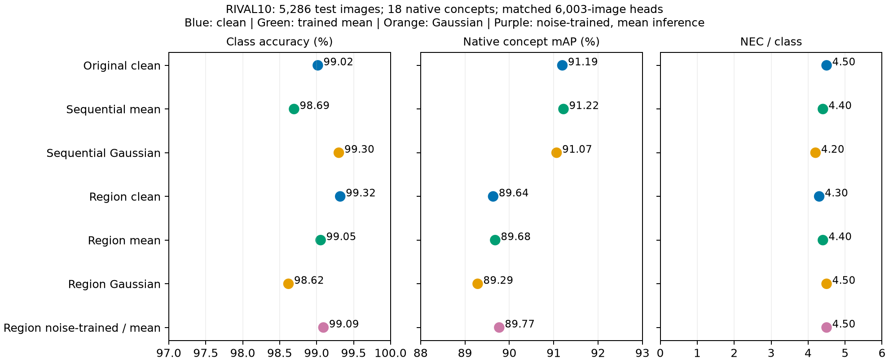
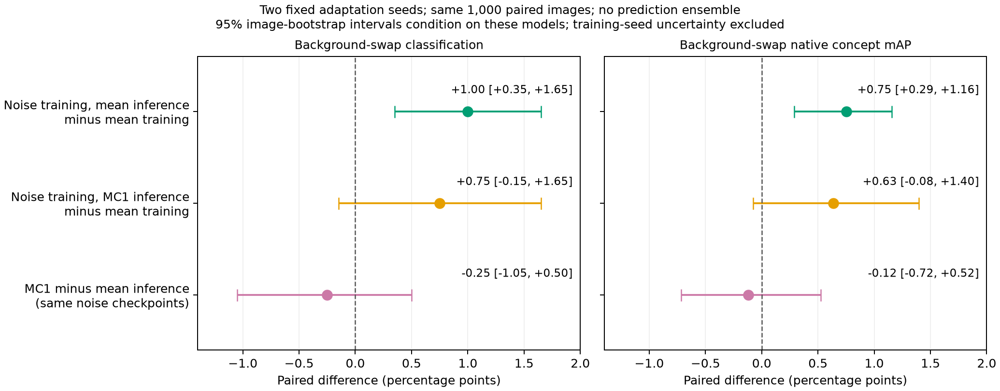
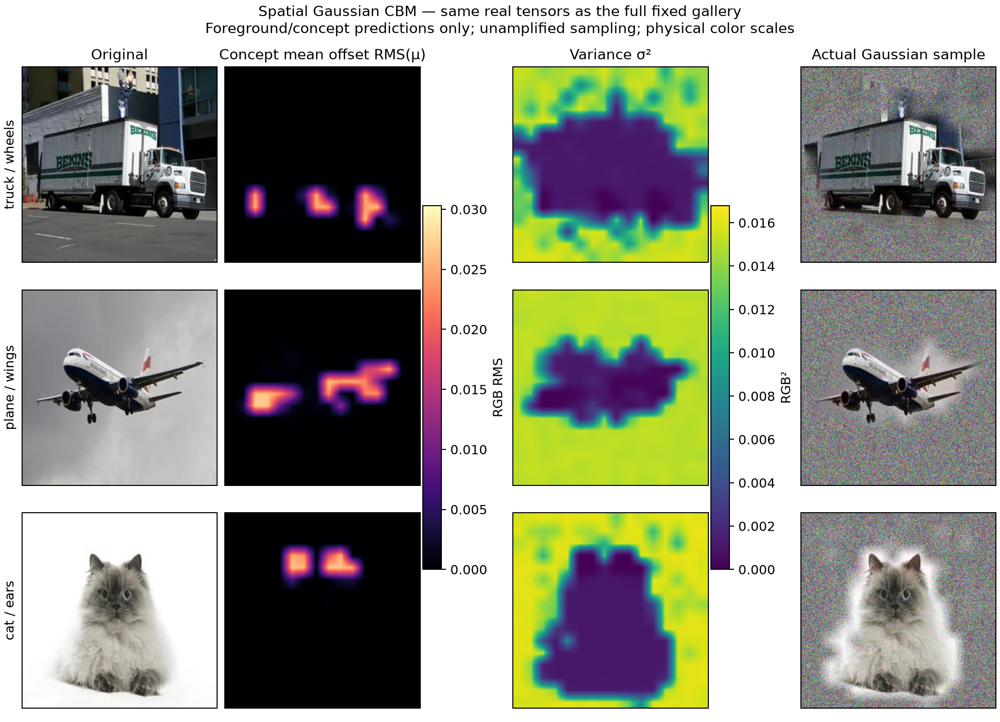

# PiNI：主要实验结果

固定 RIVAL10 测试集 5,286 张，冻结 ViT-L/14，18 个原生概念；分类仅经过概念概率与稀疏头。推理不使用真值掩膜。主表为适配 seed 42；第二种子复验单独报告，共享划分和干净初始化。区间只衡量配对测试样本不确定性。

**最终判断：**区域加噪 CBM 已实现主体保护与概念部位增强；常规测试分类约 99%、NEC 约 4.4。两个固定适配模型的平均结果支持“训练加噪、推理取均值”改善换背景分类和概念 mAP；固定阈值概念精确率与推理继续采样的额外收益尚未得到支持。

## 1. 主要性能

**目的：**同时检查分类、连接稀疏度和原生概念识别，避免只看分类分数。

| 方法 | 分类准确率 | NEC | 概念 mAP |
|---|---:|---:|---:|
| clean matched head | 99.02% | 4.5 | 91.19% |
| mean_sequential | 98.69% | 4.4 | 91.22% |
| noise_sequential | 99.30% | 4.2 | 91.07% |
| region clean matched head | 99.32% | 4.3 | 89.64% |
| region_mean | 99.05% | 4.4 | 89.68% |
| region_noise | 98.62% | 4.5 | 89.29% |
| region_noise_mean_inference | 99.09% | 4.5 | 89.77% |

**结论：**顺序噪声相对匹配均值模型，分类差 +0.61 pp，95% CI [+0.38, +0.87]；概念 mAP 差 -0.16 pp，CI [-0.38, +0.08]。分类收益主要来自训练后的适配；同检查点单次采样的额外收益尚不明确。

冻结主体匹配对照：噪声 − 均值分类差 -0.44 pp，CI [-0.72, -0.15]；概念 mAP 差 -0.31 pp，CI [-0.55, -0.06]。

## 2. 训练方式与随机项

**目的：**比较独立、顺序、完整联合及逐概念生成器；每组与自身同容量的均值模型配对。

**结论：**已完成的训练方式比较没有显示稳定的整体概念 mAP 增益。逐概念输出头能训练，但并未解决随机项的语义收益问题。完整联合的分类损失确实经过全部 18 张真实加噪 RGB 视图，仍不能靠联合训练本身保证有效。

## 3. 背景干扰

**目的：**保留主体、移植异类背景，在同一批 1,000 张测试图上区分屏蔽/均值适配和随机噪声的贡献。

**结论：**更强的局部干净基线 95.2%，完整联合均值 97.3%，随机噪声 97.1%。抗背景干扰的收益已存在于确定性模型，不能全部归给随机项。

**两次适配的平均结果：**同一批 1,000 张图与供体，分别计算指标再平均；不集成预测。

| 训练 / 推理 | 换背景分类 | 换背景概念 mAP |
|---|---:|---:|
| 均值训练 / 均值 | 95.60% | 88.06% |
| 噪声训练 / 单次采样 | 96.35% | 88.69% |
| 噪声训练 / 均值 | 96.60% | 88.81% |

**训练噪声的证据：**均值推理相对均值训练，分类 +1.00 pp，95% CI [+0.35, +1.65]；概念 mAP +0.75 pp，CI [+0.29, +1.16]。噪声 MC1 相对均值训练的分类区间 [-0.15, +1.65]、mAP 区间 [-0.08, +1.40] 均包含零。区间条件于这两个已训练模型，只反映图像抽样，不证明训练种子总体或其他数据集的稳定收益。

区域读出版本在换背景后的概念 mAP 为 89.01%，均值对照 87.92%；差 +1.09 pp，CI [+0.27, +1.85]。这是当前支持噪声训练提高背景变化下概念识别的证据，但并未同时提高常规测试分类与概念 mAP。

随机训练模型改用均值推理后，背景概念 mAP 增量仍为 +1.07 pp，CI [+0.49, +1.61]；收益不要求推理继续随机采样。

精确率与召回率分开读取：固定 0.5 阈值下，区域噪声/均值模型精确率 86.14% / 86.04%，差的 CI [-0.79, +1.03]；召回率差 +2.40 pp。当前收益不能表述为显著提高固定阈值精确率。[完整 PR 诊断](reports/spatial_noise_v1/background_precision.png)同时显示固定召回率的排序表现，曲线使用测试真值做指标评估，不提供测试选阈值。

冻结主体的换背景随机增量 +0.40 pp，CI [-0.40, +1.10]。

**第二适配种子复验：**使用同样的区域模型、超参数、干净初始化、测试图与供体，仅改变适配训练随机种子；换背景概念 mAP 差 +0.18 pp，CI [-0.68, +1.01]。这不是端到端独立预训练的多种子结果。

第二适配种子的换背景分类差 +1.20 pp，CI [+0.10, +2.40]。

## 4. Figure 4 风格真实分布

**目的：**在预先选定验证样本上显示实际 μ、σ² 和采样 RGB；所有图使用物理单位，采样不放大。

发现的失效机制：原顺序随机模型将 95.0% 的真实背景判为主体，主体 IoU 为 37.7%。背景方差较高的热图并不能证明屏蔽器正确。

区域模型全部 9022 个正概念/图像对：背景/主体方差 6.44，主体/背景 μ 11.88；4080 个局部部位的 μ/主体其他部分为 10.39。图中的主体/背景与概念部位分离有全验证集统计支持。

第二适配种子对应全验证集比值为 7.61 / 10.57 / 10.56；实际主体×概念读出区域 IoU 为 47.00%。空间模式可复现，细粒度定位仍有限。

主图取原预定六个样本中的前三个，便于阅读；[完整六样本](reports/spatial_noise_region/figure4_style.png)与[同图不同概念](reports/spatial_noise_region/concept_conditioning.png)保留小部位漏定位等失败情况。

冻结主体版本实际图见[对照图库](reports/spatial_noise_fixed/figure4_style.png)；该图与性能一起读取。

**结论：**冻结主体后，权重与固定验证主体概率变化均为零；全 2103 张有效验证图的背景/主体方差 5.67，主体/背景 μ 14.32。空间分离来自明确先验，实际收益仍需读取前述匹配对照。

## 5. 官方 PiNI 与 LF-Pi 的解释

**目的：**区分官方主方法、图像 CNN 和自身 LF-Pi 中训练适配、随机采样的贡献。

官方 OxfordPets AMP 主方法：单次 89.26%，MC8 91.50%，独立均值模型 90.02%；图像 CNN 的 MC8 89.51%，与独立均值模型相同。默认 FP16 图像 CNN 在全部 147 张有效验证图上的背景/主体方差比仅 1.07，未复现稳定的理想空间分离。MC8 是新增采样诊断，不能当作论文原始协议的精确复现。

**结论：**本次 PiNI 主方法收益包含采样平均；LF-Pi 匹配对照中均值 88.44%、随机 MC8 88.42%，大幅提升与 NEC 下降主要支持任务投影/均值适配，尚不能解释为随机噪声清除了背景。

注意：这 18 个真值二元概念在当前测试样本上的标签重叠上限为 93.40%；它不约束真实连续语义强度，但说明 99% 分类成绩不能单独证明概念准确或纯净。

完整负结果、逐概念精确率/召回率、配对区间、定位、MC 和复现协议见 [EXPERIMENT_REPORT.md](EXPERIMENT_REPORT.md) 与 [RESEARCH_PROTOCOL.md](RESEARCH_PROTOCOL.md)；实现、推理命令和逐项目标核验见 [GOAL_VERIFICATION.md](GOAL_VERIFICATION.md)。
