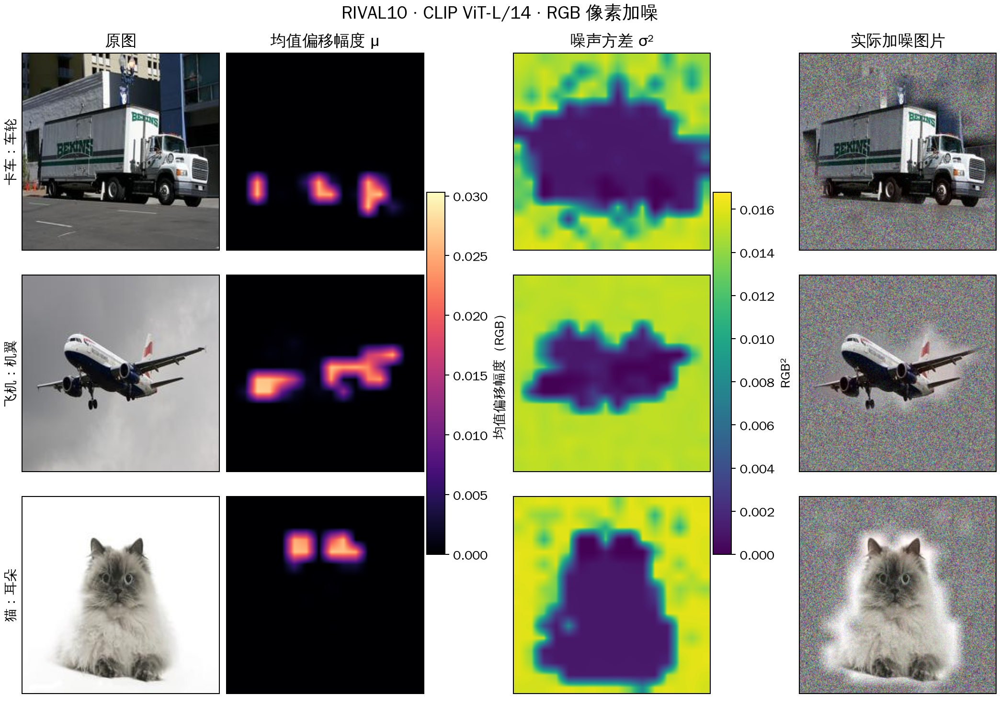
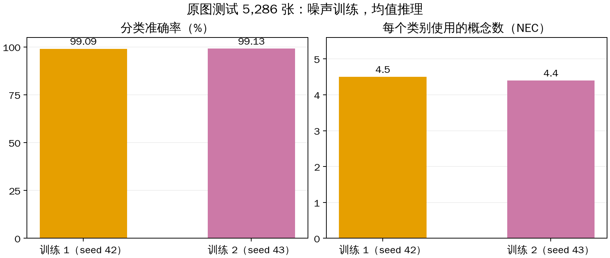
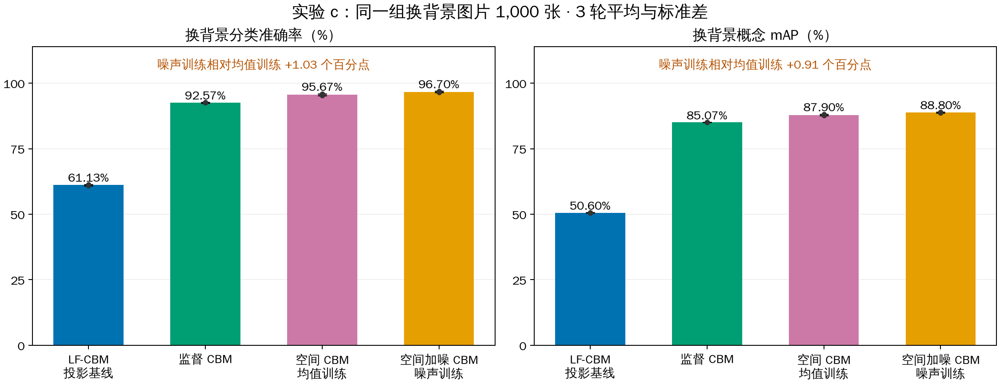

# 空间加噪 CBM：主要实验结果

- 空间 CBM 实现了真实的“背景高方差、概念部位大均值偏移”效果。
- 噪声训练后均值推理：分类约 **99.1%**，NEC **4.4–4.5**。
- 两个固定适配模型平均：换背景分类 **+1.00 个百分点**、概念 mAP **+0.75 个百分点**。

## 模型怎么工作

图中从上到下依次是：学习主体与概念区域、在 RGB 像素上训练噪声、取均值图预测 18 个概念并分类。

使用 **RIVAL10**，包含卡车、飞机、猫等 10 个类别，以及车轮、机翼、耳朵等 18 个概念。Backbone 是冻结的 **CLIP ViT-L/14**。模型结合图像特征和概念文本，找出主体和相应部位，先减弱背景，再在原图的 **RGB 像素**上加噪：背景的随机扰动更强，概念部位的均值偏移更大。每个概念对应一张处理后的图片，再由 ViT 识别；最后用 18 个概念的预测概率完成分类。

训练顺序是先学概念和区域，再训练噪声生成器与概念识别器，最后训练稀疏分类头。区域模型用 18,987 张训练图预训练；加噪阶段用 6,003 张图训练 6 轮，分别运行 seed 42 和 43。训练时使用随机采样，性能测试时使用学到的均值。

## 实验一：噪声是否集中在该放的位置

**目的：**观察背景是否受到更强随机扰动，车轮、机翼、耳朵等概念部位是否得到更大的均值偏移。

**怎么跑：**RIVAL10 验证集 2,111 张，backbone 为 CLIP ViT-L/14；在 RGB 像素上生成概念对应的均值 μ 和方差 σ²。图中从左到右为原图、均值偏移、噪声方差、实际加噪图片。

**指标含义：**μ 的幅度表示像素被稳定改变多少，σ² 表示随机扰动有多强。均值图越亮，偏移越大；方差图越黄，扰动越强，紫色表示较弱。统计覆盖 9,022 个有效正概念区域，其中 4,080 个是车轮、耳朵等局部部位。

| 空间指标 | 训练 1 | 训练 2 |
|---|---:|---:|
| 背景方差 / 主体方差 | 6.44 倍 | 7.61 倍 |
| 主体均值偏移 / 背景均值偏移 | 11.88 倍 | 10.57 倍 |
| 概念部位均值偏移 / 主体其他部位均值偏移 | 10.39 倍 | 10.56 倍 |

**结论：**背景受到更强随机扰动，均值偏移集中在主体，尤其是当前要识别的概念部位。

## 实验二：分类准确率和概念使用数量

**目的：**检查这个模型能否正确分类，以及每个类别需要多少概念。

**怎么跑：**RIVAL10 原图测试集 5,286 张，backbone 为 CLIP ViT-L/14。使用噪声训练得到的模型，按预测区域减弱背景，在 RGB 像素上施加学到的均值，再预测概念并分类。

**指标含义：**分类准确率是图片类别预测正确的比例，越高越好。NEC 是每个类别平均实际使用的概念数；越低，分类所依赖的概念越少。

| 训练 | 分类准确率 | NEC |
|---|---:|---:|
| 训练 1（seed 42） | 99.09% | 4.5 |
| 训练 2（seed 43） | 99.13% | 4.4 |

**结论：**噪声训练后均值推理的分类准确率约 99.1%，每个类别平均使用 4.4–4.5 个概念。

## 实验三：换背景后是否更容易认对

**目的：**检查背景变化时，训练加噪能否帮助识别概念和图片类别。

**怎么跑：**从 RIVAL10 测试集取 1,000 张图，保留主体，把背景换成其他类别图片的背景。Backbone 仍为 CLIP ViT-L/14；两组分别用“只学均值”和“均值加随机噪声”训练，噪声加在 RGB 像素上，测试时两组都取均值。分别计算 seed 42、43 的指标，再取平均。

**指标含义：**分类准确率衡量换背景后能否认对类别。概念 mAP 先对每个概念计算平均精度 AP，再对 18 个概念取平均；它衡量模型能否把真正具有该概念的图片排在前面，越高越好。百分点是两个百分比直接相减。

| 训练方式 | 换背景分类准确率 | 换背景概念 mAP |
|---|---:|---:|
| 均值训练 | 95.60% | 88.06% |
| 噪声训练 | 96.60% | 88.81% |
| 提升 | **+1.00 个百分点** | **+0.75 个百分点** |

**结论：**训练时加入概念条件噪声，让模型在背景改变后更容易认对概念和类别。
