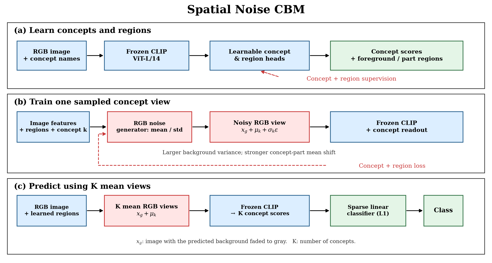
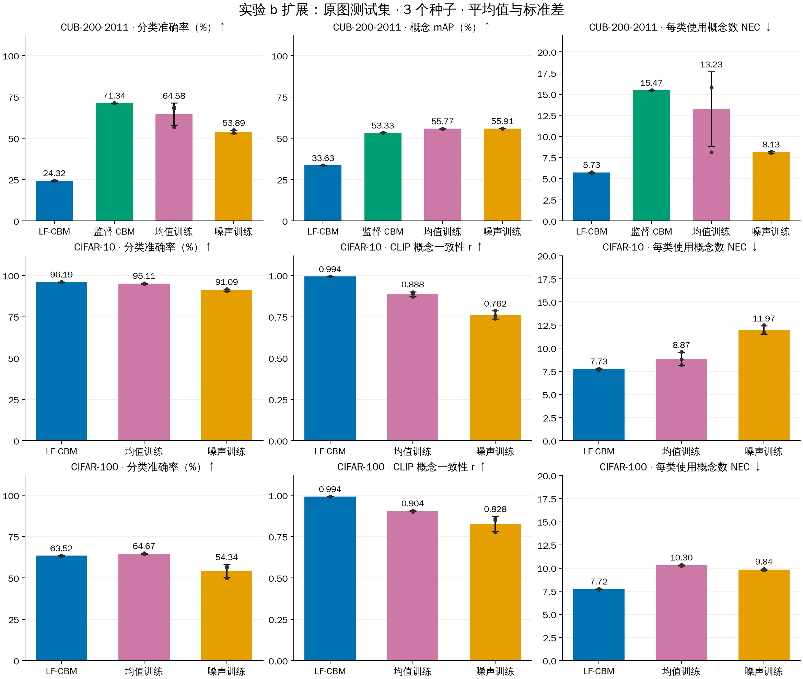
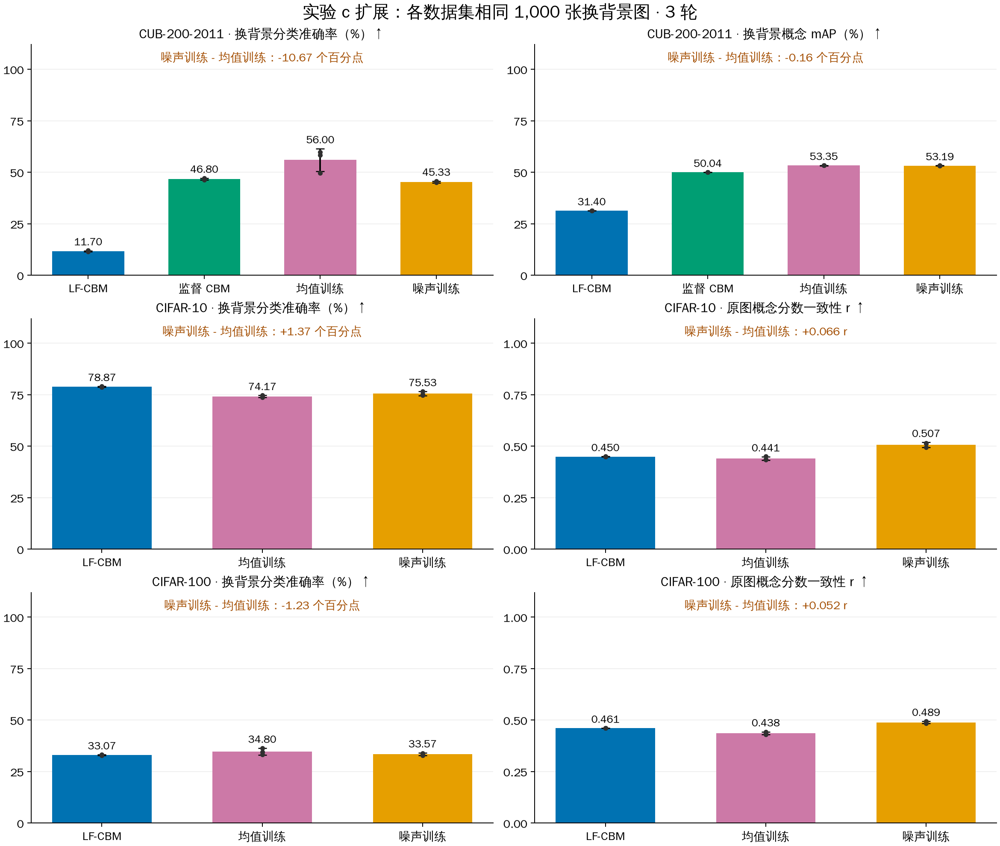

# 空间加噪 CBM 实验报告

在 RIVAL10 上，空间加噪模型呈现“背景高方差、概念部位大均值偏移”的分布特征：噪声训练后使用均值视图推理，分类准确率达到 **99.12%**，NEC 为 **4.43**；换背景测试中，相对均值训练组，分类准确率提升 **1.03%**，概念 mAP 提升 **0.91%**。在 CUB 与 CIFAR 数据集上，扩展结果出现下降。

## 方法

模型使用冻结的 **CLIP ViT-L/14** 骨干。首先利用概念标签、主体分割及区域标注预训练概念识别器与区域预测器；随后在 **RGB 像素**空间生成对应概念的均值偏移 $\mu$ 与噪声尺度 $\sigma$。训练时加入扰动 $x' = x + \mu + \sigma \odot \epsilon$（$\epsilon \sim \mathcal{N}(0, I)$），使背景承受更强的随机扰动，概念部位获得集中的均值偏移。测试时生成 $\mu$ 视图预测概念分数，并通过线性分类头完成类别预测。

- **对照设置**：均值训练组仅学习 $\mu$，噪声训练组同时学习 $\mu$ 与 $\sigma$；两组推理阶段均使用均值视图。
- **训练流程**：区域预测预训练 40 轮，像素加噪适配 6 轮。
- **实验重复**：报告结果为 3 个随机种子（42, 43, 44）的均值 ± 标准差。

## 数据集与评测配置

| 数据集 | 类别数 / 概念数 | 划分（训练 / 验证 / 测试） | 标注来源 |
|---|---:|---|---|
| RIVAL10 | 10 / 18 | 18,987 / 2,111 / 5,286 | 原生概念标签、主体与部位区域标注 |
| CUB-200-2011 | 200 / 112 | 5,394 / 600 / 5,794 | 鸟类属性标签、主体分割与部位标注 |
| CIFAR-10 | 10 / 64 | 45,000 / 5,000 / 10,000 | CLIP 概念软分数；Grounding DINO + SAM2 区域 |
| CIFAR-100 | 100 / 128 | 45,000 / 5,000 / 10,000 | CLIP 概念软分数；Grounding DINO + SAM2 区域 |

评测指标包括：分类准确率（Accuracy）、概念 mAP（针对离散概念标签）、概念相关系数 $r$（针对 CLIP 软标签）、有效概念数（NEC, $|w_k| > 10^{-5}$），以及背景/主体方差比、主体/背景均值幅度比等空间统计量。

## 实验一：空间噪声与均值分布

在验证集上评估生成的 $\mu$ 与 $\sigma^2$ 分布（RIVAL10 为 2,111 张验证图，其余各 500 张固定验证图）：

| 数据集 | 背景 / 主体方差比 | 主体 / 背景均值比 | 概念部位 / 其余主体均值比 |
|---|---:|---:|---:|
| RIVAL10 | 7.06 ± 0.58 | 12.10 ± 1.64 | 10.31 ± 0.29 |
| CUB | 5.13 ± 0.37 | 32.62 ± 1.22 | 7.06 ± 0.80 |
| CIFAR-10 | 3.33 ± 0.33 | 3.60 ± 0.63 | 2.67 ± 0.08 |
| CIFAR-100 | 1.97 ± 0.48 | 2.23 ± 0.12 | 2.17 ± 0.04 |

四个数据集均呈现背景扰动强、部位均值偏移集中的空间分布。在 RIVAL10 上，背景方差约为主体的 7.06 倍，概念部位均值幅度约为其余主体部位的 10.31 倍。

## 实验二：原图分类与概念识别性能

在各数据集完整测试集上的分类准确率、概念指标与 NEC 对比如下：

| RIVAL10 方法 | 分类准确率 (%) ↑ | 概念 mAP (%) ↑ | NEC ↓ |
|---|---:|---:|---:|
| LF-CBM | 90.33 ± 0.02 | 56.67 ± 0.04 | 5.10 ± 0.00 |
| 监督 CBM | 99.58 ± 0.00 | 89.87 ± 0.00 | 4.10 ± 0.00 |
| 噪声训练 (均值推理) | **99.12 ± 0.02** | 89.73 ± 0.05 | **4.43 ± 0.06** |

| 数据集 | 方法 | 分类准确率 (%) ↑ | 概念指标 ↑ | NEC ↓ |
|---|---|---:|---:|---:|
| CUB | LF-CBM | 24.32 ± 0.24 | mAP 33.63 ± 0.00% | 5.73 ± 0.05 |
| CUB | 监督 CBM | 71.34 ± 0.10 | mAP 53.33 ± 0.00% | 15.47 ± 0.01 |
| CUB | 均值训练 | 64.58 ± 6.75 | mAP 55.77 ± 0.10% | 13.23 ± 4.43 |
| CUB | 噪声训练 | 53.89 ± 1.04 | mAP 55.91 ± 0.07% | 8.13 ± 0.07 |
| CIFAR-10 | LF-CBM | 96.19 ± 0.00 | r 0.994 ± 0.000 | 7.73 ± 0.06 |
| CIFAR-10 | 均值训练 | 95.11 ± 0.28 | r 0.888 ± 0.014 | 8.87 ± 0.70 |
| CIFAR-10 | 噪声训练 | 91.09 ± 0.63 | r 0.762 ± 0.025 | 11.97 ± 0.46 |
| CIFAR-100 | LF-CBM | 63.52 ± 0.07 | r 0.994 ± 0.000 | 7.72 ± 0.04 |
| CIFAR-100 | 均值训练 | 64.67 ± 0.30 | r 0.904 ± 0.003 | 10.30 ± 0.06 |
| CIFAR-100 | 噪声训练 | 54.34 ± 3.90 | r 0.828 ± 0.045 | 9.84 ± 0.08 |

在 RIVAL10 上，噪声模型分类准确率保持在 99.12%，平均使用 4.43 个概念。在 CUB、CIFAR-10 和 CIFAR-100 上，相比均值训练，噪声训练在原图上的分类准确率分别下降 10.69%、4.02% 和 10.33%。

## 实验三：背景替换鲁棒性测试

固定各数据集 1,000 张测试图像，保留前景主体，替换为其他类别图像的背景，评估模型在背景扰动下的分类与概念识别鲁棒性：

| 数据集 | 均值训练准确率 (%) | 噪声训练准确率 (%) | 准确率变化 (百分点) | 概念指标变化 |
|---|---:|---:|---:|---|
| RIVAL10 | 95.67 ± 0.32 | 96.70 ± 0.26 | **+1.03** | mAP **+0.91%** |
| CUB | 56.00 ± 5.51 | 45.33 ± 0.42 | **-10.67** | mAP -0.16% |
| CIFAR-10 | 74.17 ± 0.50 | 75.53 ± 1.04 | **+1.37** | r +0.066 |
| CIFAR-100 | 34.80 ± 1.61 | 33.57 ± 0.59 | **-1.23** | r +0.052 |

在 RIVAL10 和 CIFAR-10 上，加噪训练对换背景分类分别带来 +1.03% 与 +1.37% 的提升；而在 CUB 和 CIFAR-100 上，换背景表现分别下降 10.67% 与 1.23%。
