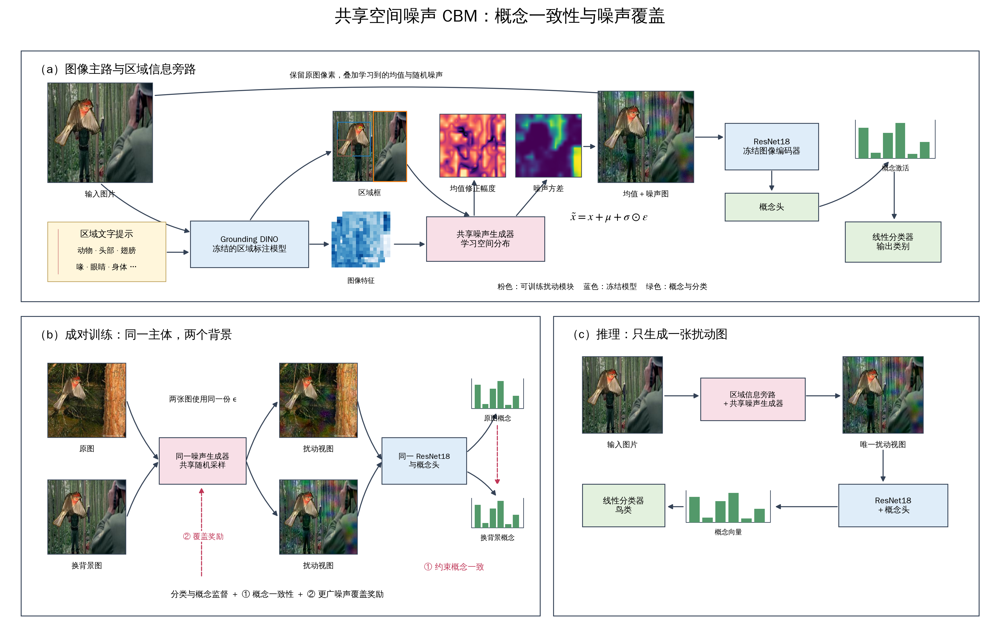
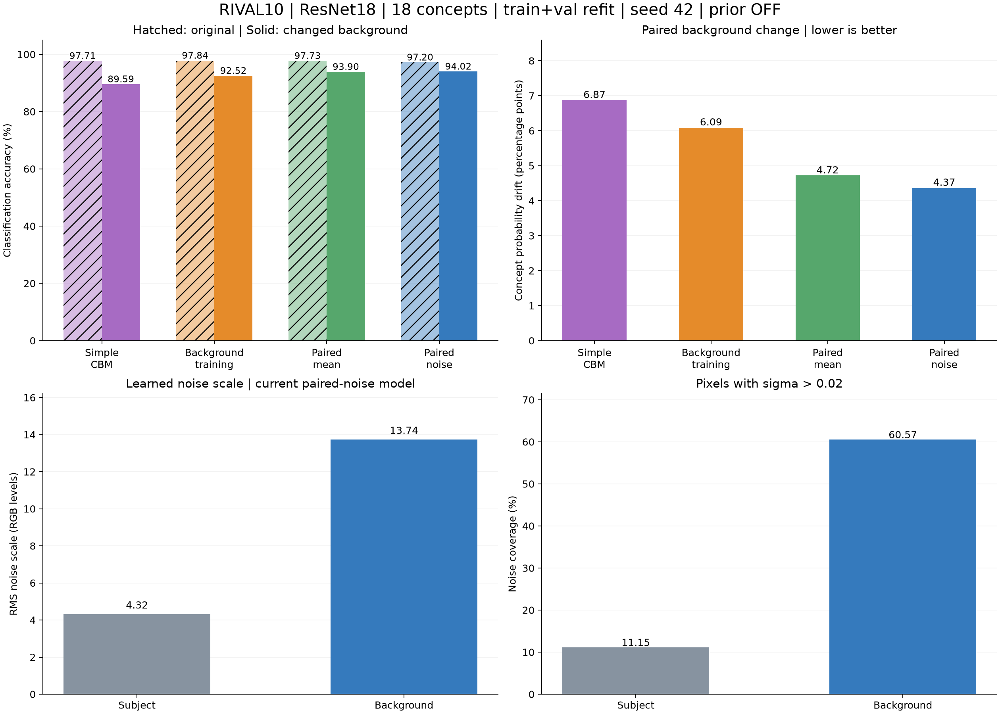
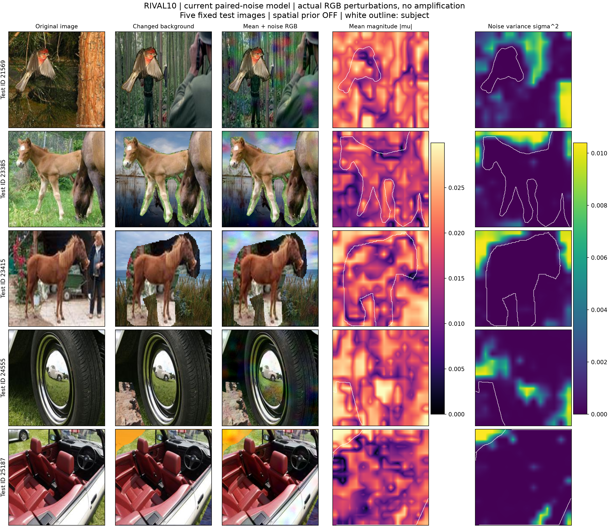

# 共享空间噪声 CBM 实验结果

## 方法流程与本轮新增方法

使用冻结的 Grounding DINO 提取图像特征和区域框，小型共享噪声生成器输出 RGB 均值修正与噪声尺度，再将扰动图输入冻结的 ResNet18、概念头和线性分类器。训练和推理使用均值＋噪声视图，空间噪声先验关闭。

本轮在 RIVAL10 的训练中新增两项：

- **直接约束换背景前后的概念一致性**：同一主体的原图与换背景图共享随机噪声，用两张扰动图的概念概率均方误差约束概念偏移，损失权重为 30。
- **奖励更广的噪声覆盖**：加入 `−0.01 × mean(log(σ / 0.102))`，鼓励模型在分类与概念监督下维持更广的噪声覆盖。该奖励作用于整张图，不指定背景位置。

## RIVAL10：ResNet18，18 个概念，seed 42

使用 RIVAL10 的原图与保留主体的随机换背景图。选定配置后在 21,098 张训练＋验证图上重新训练，测试集含 5,286 张原图，其中 5,282 张用于换背景评估。

### 分类准确率、概念偏移与噪声覆盖

### 原图、换背景图、扰动图与均值／方差图

## Waterbirds：CUB＋Places 随机背景构造，ResNet18，112 个概念，seed 42

按 CUB 鸟种划分水鸟／陆鸟二分类，将鸟主体放到随机抽取的 Places 背景上。使用在 CUB 上训练过的 ResNet18，在 5,994 张训练＋验证图上重新训练，测试 5,794 张图。

### 原图与换背景结果

### RGB 扰动与空间分布

## CUB：ResNet18，112 个官方概念，seed 42

使用完整 CUB 官方划分、200 类鸟种和 112 个概念，backbone 为在 CUB 上训练过的 ResNet18。选定配置后在 5,994 张训练＋验证图上重新训练，测试 5,794 张图。

### 原图与换背景结果

### RGB 扰动与空间分布

## 当前观察

- **可视化**：模型自发增强了背景噪声覆盖，但视觉上仍不明显。RIVAL10 中背景噪声覆盖为 60.57%，主体为 11.15%（阈值 σ＞0.02）；被分类的物体主体尚未出现类似 PiNI Figure 4 中木桶表面光泽增强的效果。
- **指标**：换背景后，RIVAL10 和 Waterbirds 的分类准确率均高于单纯的 background training。RIVAL10 为 **92.52% → 94.02%（＋1.50 个百分点）**；Waterbirds 为 **91.13% → 91.18%（＋0.05 个百分点）**。
