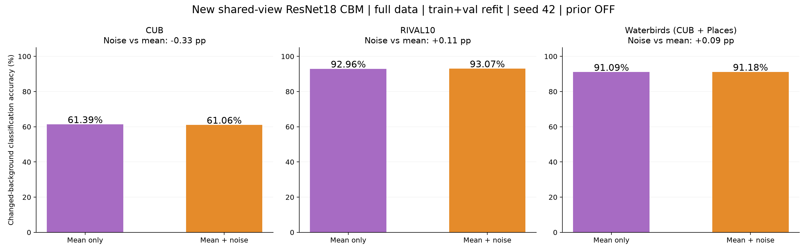
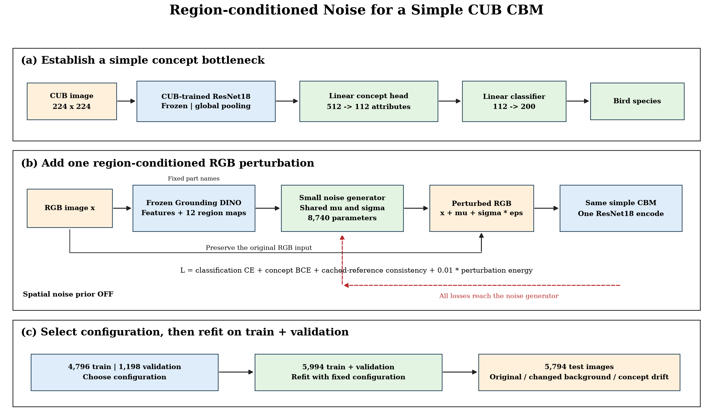
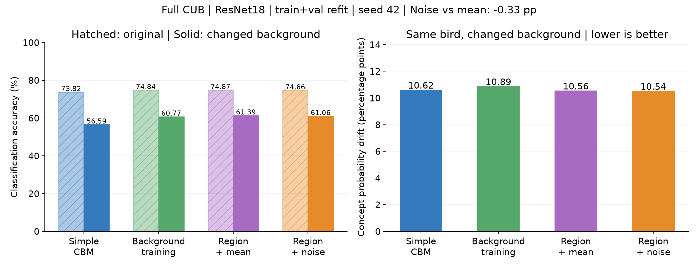
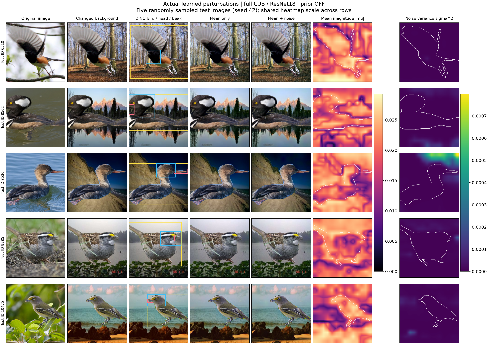
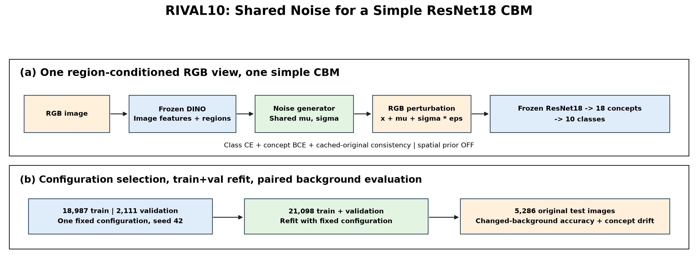
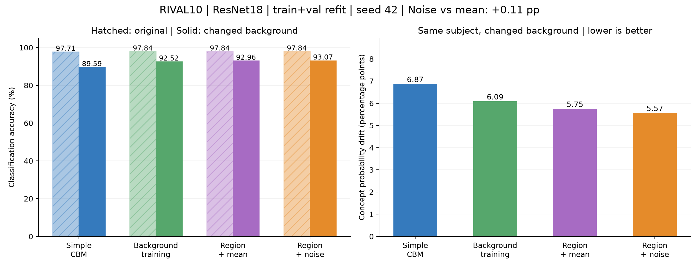
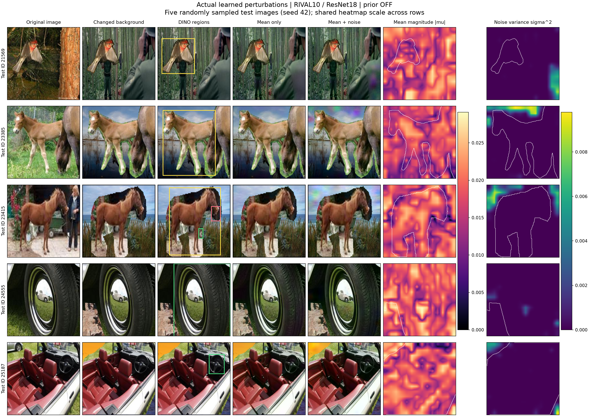
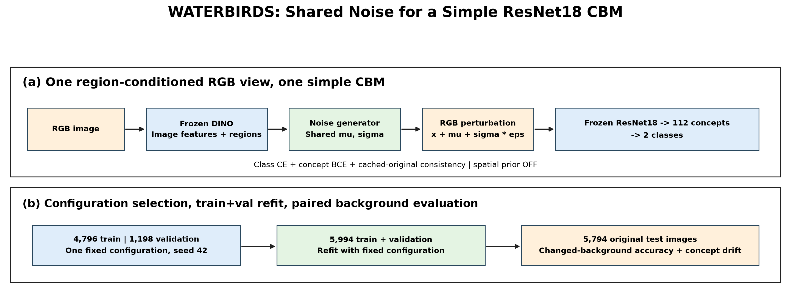
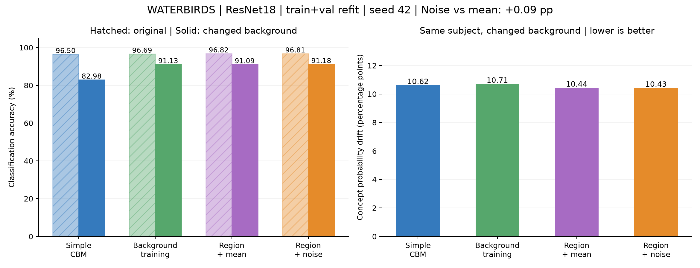
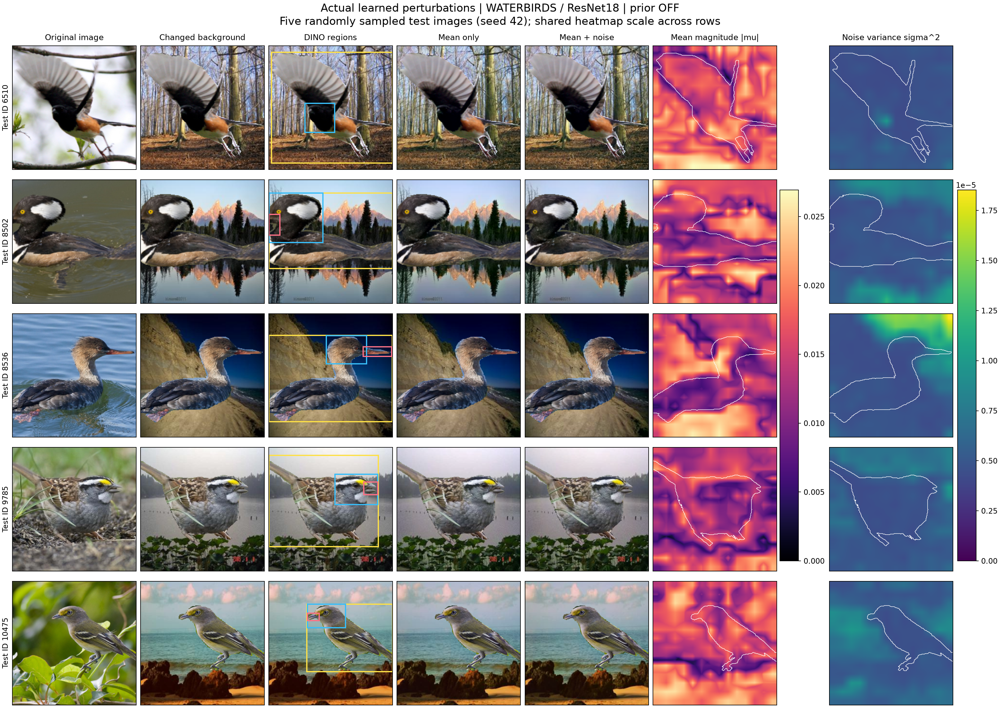

# ResNet18 共享扰动 CBM 实验结果

## CUB、RIVAL10、Waterbirds：换背景分类准确率

## CUB-200-2011：ResNet18、112 个概念、seed 42

### Pipeline

### 原图、换背景分类准确率与概念激活偏移

### RGB 扰动、均值与噪声方差

## RIVAL10：ResNet18、18 个概念、seed 42

### Pipeline

### 原图、换背景分类准确率与概念激活偏移

### RGB 扰动、均值与噪声方差

## Waterbirds（CUB + Places）：ResNet18、112 个概念、seed 42

### Pipeline

### 原图、换背景分类准确率与概念激活偏移

### RGB 扰动、均值与噪声方差

